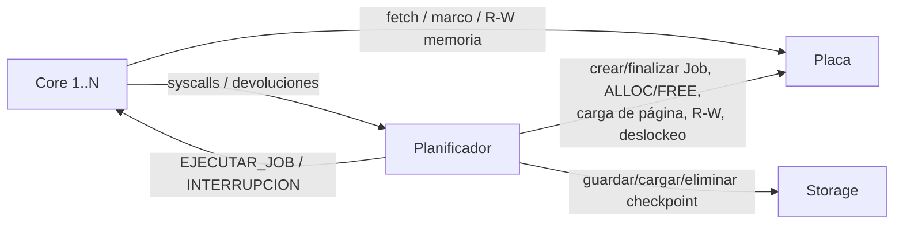

# TP EntrenadOS 2C2026: Inicio

Esta es la documentación de trabajo del TP **EntrenadOS** (grupo *RequiemSO*). Está fuera del repositorio `tp-2026-2c-requiemso`, para que sirva de planificación y consulta sin ensuciar el código.

> [!info] Fuente
> La documentación se armó a partir de la rama `develop` y de las ramas remotas sin mergear al **29/10/2026**. Se actualizó el **30/10** con el trabajo del Check 3 en la rama `planificador`, y el **14/11** con el Check 3 ya integrado en `develop` (`5922131`). Cada función indica si está en `develop` o solo en su rama.

## Planificación
- [[Plan de acción]]: qué falta, en qué orden y para qué checkpoint
- [[Estado de ramas]]: qué tiene cada rama y cómo integrarlas
- [[Despliegue distribuido]]: servidores de prueba y `deploy/desplegar.sh` (cómo correr pruebas en varias máquinas)
- [[Mini Entrenamiento 2026-11-14]]: primera prueba de punta a punta con los módulos reales (Check 3)
- [[Presentación - Funcionamiento del TP]]: diapositivas que explican el TP de punta a punta (abrir con *Slides: Start presentation*)

## Módulos
| Módulo | Nota | Rol |
| --- | --- | --- |
| Planificador | [[Planificador]] | Colas de Jobs, corto/largo plazo, syscalls, servicios |
| Core | [[Core]] | Ciclo de instrucción, MMU, pedido de syscalls |
| Placa | [[Placa]] | Instrucciones, memoria paginada, offload, reemplazo |
| Storage | [[Storage]] | FS `FAT32_TRAIN`, checkpoints, consola |
| Utils | [[Utils]] | Sockets, serialización, config/logger compartidos |

- [[Protocolo]]: opcodes, payloads y enums compartidos (`protocolo_entrenados.h`)

## Arquitectura

**Orden de arranque:** Placa y Storage → Planificador (se conecta a ambos y recién después abre su servidor) → Cores.

## Calendario
| Hito | Fecha | Contenido |
| --- | --- | --- |
| Check 1 | 12/09 | Conexiones y serialización ✅ |
| Check 2 | 10/10 | Planificación básica FIFO/RR ✅ (+ HRRN) |
| Check 3 | 31/10 | Memoria, paginación, syscalls, servicios, BLOCKED ✅ (integrado y probado el 14/11) |
| **Check 4** | **14/11** | Storage y persistencia (checkpoints) ⏳ |
| Entregas | 28/11 · 12/12 · 19/12 | Pruebas end-to-end y coloquio |
