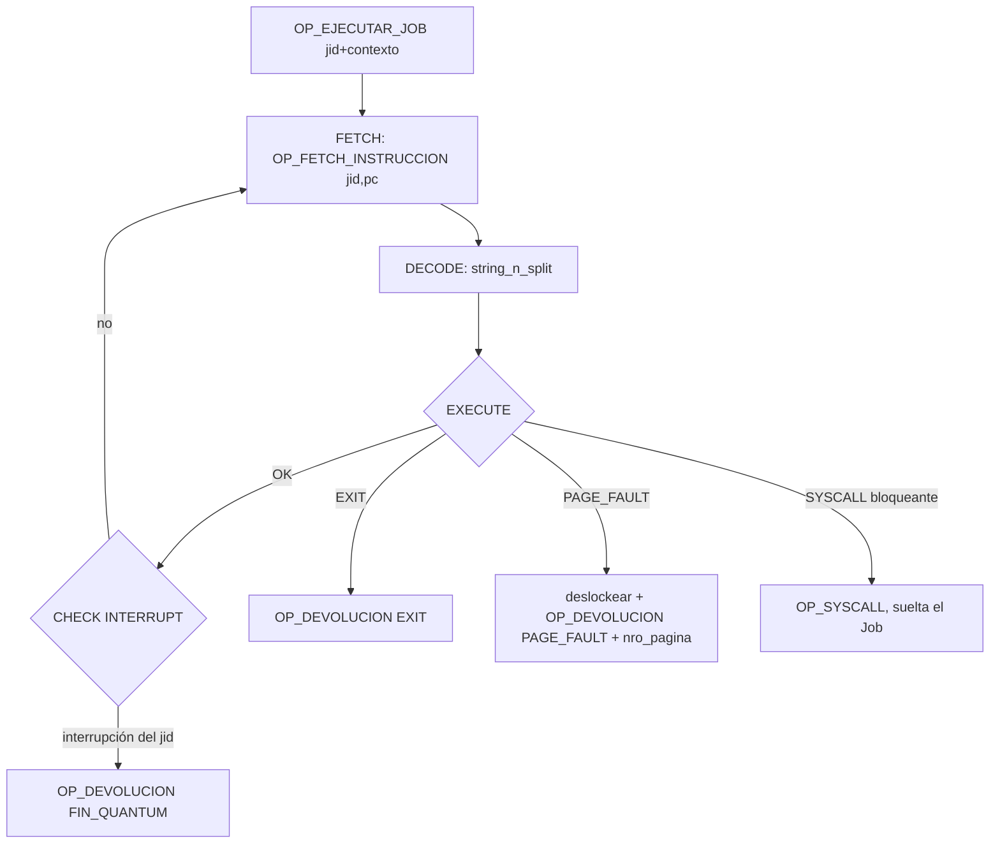

# Core

Volver a [[00 - Inicio]] · Depende de [[Utils]] y [[Protocolo]] · Habla con [[Planificador]] y [[Placa]]

Es el ejecutor de Jobs. Recibe un Job (`jid` + contexto) del Planificador y corre el ciclo **Fetch → Decode → Execute → Check Interrupt** pidiendo cada instrucción a la Placa. Traduce direcciones con su MMU y pide syscalls al Planificador. Puede haber N Cores, cada uno con un identificador propio.

**Ejecución:** `./bin/core [Archivo Config] [Identificador]` (configs de ejemplo: `core1.config`, `core2.config`)

## Estado
Todo en `develop`.

| Funcionalidad | Estado | Commit / PR |
| --- | --- | --- |
| Conexión y handshake con Planificador y Placa; recibe `OP_TAM_PAGINA` | ✅ | #12 |
| NOOP, SET, SUM, SUB, JNZ, EXIT | ✅ | Check 2 |
| INIT_JOB (no bloqueante) | ✅ | Check 2 |
| Check Interrupt (fin de quantum, filtra por `jid`) | ✅ | Check 2 |
| MMU: división en tramos por página, traducción, page fault | ✅ | #12 |
| FORWARD / BACKWARD / UPDATE | ✅ | #12 |
| LOAD_BATCH, LABEL, REPORT, SAVE/LOAD/DELETE_CHECKPOINT (envío de la syscall con los tramos) | ✅ | #12 |
| ALLOC / FREE | ✅ | `5ba1c3b` (#17) + `69c087f` (#19) |

> [!success] Probado
> La suite de la cátedra del CP2 y el CP3 pasa completa: registros, FETCH, MMU, cruce de página y page faults. Ver [[Suite cátedra 2026-11-14]].

> [!success] Resuelto en `69c087f` (PR #19, 14/11)
> - Agregué `EJEC_JOB_FINALIZADO` a `t_resultado_ejecucion`.
> - **`FREE` con `ok=false`:** loguea un warning y el Job sigue.
> - **`ALLOC` con `ok=false`:** loguea un warning y abandona el Job **sin devolverlo**.
>
> Se probó con los módulos reales: después de un FREE inválido y un ALLOC sin espacio, el Core siguió conectado y ejecutó el Job siguiente.

> [!bug]- Historial: `FREE` con `ok=false` desconectaba al Core
> ALLOC y FREE se conectaron en `5ba1c3b` (PR #17), pero el manejo de `ok=false` no respetaba el contrato con el [[Planificador]]:
> - **`FREE` (bug):** hace `goto error` → `EJEC_ERROR` → `ejecutar_ciclo_instruccion` devuelve `false` → `atender_jobs_planificador` corta y **el Core se desconecta**. El Planificador devuelve el Job a READY y, si era el único Core, el sistema se traba. Lo correcto: loguear un warning y continuar (`break`).
> - **`ALLOC` (cosmético):** devuelve `EJEC_EXIT`, así que manda un `OP_DEVOLUCION EXIT` de un Job que el Planificador ya finalizó (`OUT_OF_MEMORY`). El Planificador lo ignora con un warning. Lo acordado era abandonar el Job sin devolverlo.

## Ciclo de instrucción

---

## `main.c`
| Función | Descripción |
| --- | --- |
| `main` | `inicializar_core` → `conectar_con_modulos` (recibe el tamaño de página) → `mmu_init(tam_pagina)` → `atender_jobs_planificador` → `terminar_programa_core` |

## `utils.c` / `utils.h`
| Función / tipo | Descripción |
| --- | --- |
| `inicializar_core(t_config**, t_log**, path_config, identificador)` | Config y logger por Core |
| `terminar_programa_core(fd_plani, fd_placa, config, logger)` | Cierra los sockets y libera |
| `t_instruccion_tipo` | `NOOP, SET, SUM, SUB, JNZ, EXIT, INIT_JOB, INVALIDA, FORWARD, BACKWARD, UPDATE, ALLOC, FREE, LOAD_BATCH, LABEL, REPORT, SAVE/LOAD/DELETE_CHECKPOINT` |
| `t_resultado_ejecucion` | `EJEC_OK, EJEC_EXIT, EJEC_PAGE_FAULT, EJEC_SYSCALL_BLOQUEANTE, EJEC_JOB_FINALIZADO` (el Planificador ya finalizó el Job: se abandona sin devolverlo)`, EJEC_ERROR` |
| `t_tramo_pagina` | `{nro_pagina, desplazamiento, tamanio}` |
| `t_acceso_fisico` | `{direccion_fisica, tamanio}` |
| `t_resultado_mmu` / `t_resultado_marco` | `OK / PAGE_FAULT / ERROR` |

## `comunicacion.c` / `comunicacion.h`
| Función | Descripción |
| --- | --- |
| `crear_conexion_planificador` / `crear_conexion_placa` | `crear_conexion` con IP y puerto del config |
| `realizar_handshake(fd, identificador, modulo, logger)` | `handshake_cliente` como `MODULO_CORE` con `id_core` |
| `conectar_con_modulos(logger, config, id, &fd_plani, &fd_placa, &tam_pagina)` | Conecta a los dos y recibe `OP_TAM_PAGINA {uint32}` de la Placa |
| `recibir_tamanio_pagina(fd_placa, logger)` | Lee el `OP_TAM_PAGINA` que manda la Placa después del handshake |
| `solicitar_instruccion_a_placa(fd_placa, jid, pc, logger)` | `OP_FETCH_INSTRUCCION {jid, pc}` → `OP_RSP_FETCH {ok, string}`. Devuelve un `char*` que libera el caller |
| `enviar_devolucion_planificador(fd, jid, contexto, motivo, logger)` | `OP_DEVOLUCION {uint32 jid, uint8 motivo, contexto}` |
| `hay_interrupcion_pendiente(fd, jid_actual, logger)` | `recv` no bloqueante (`MSG_PEEK`) para ver si llegó `OP_INTERRUPCION`; descarta interrupciones de otro `jid`. Usa la bandera `interrupcion_guardada` si llegó mientras esperaba una respuesta de syscall |
| `interrupcion_es_del_job(buffer, jid)` | Lee el `jid` de la interrupción y lo compara |
| `registrar_interrupcion_guardada` / `reiniciar_interrupcion_guardada` | Guardan la interrupción que llegó mientras se esperaba la respuesta de una syscall. Se reinicia en cada despacho nuevo |
| `solicitar_init_job(fd, jid, contexto, archivo, logger)` | `OP_SYSCALL {INIT_JOB, jid, contexto, string archivo}` → espera `OP_RSP_SYSCALL`, guardando las interrupciones que lleguen en el medio |

## `ejecucion.c` / `ejecucion.h`
| Función | Descripción |
| --- | --- |
| `atender_jobs_planificador(logger, fd_plani, fd_placa)` | Loop: `OP_EJECUTAR_JOB` → deserializa jid+contexto → `ejecutar_ciclo_instruccion`. Descarta `OP_INTERRUPCION` si no hay un Job ejecutando |
| `ejecutar_ciclo_instruccion(jid, contexto, fd_plani, fd_placa, logger)` | Fetch/Decode/Execute/Check Interrupt hasta EXIT, desalojo, PF, syscall bloqueante o `EJEC_JOB_FINALIZADO`. Devuelve `false` ante un error de comunicación (y el Core se desconecta) |
| `ejecutar_entrenamiento(tipo, tokens, contexto, …)` | FORWARD/BACKWARD/UPDATE: traduce los rangos con la MMU, lee y escribe en la Placa y opera sobre los registros E1 a E3 |

## `instrucciones.c` / `instrucciones.h`
| Función | Descripción |
| --- | --- |
| `parsear_operacion(op)` | Texto → `t_instruccion_tipo` (sin distinguir mayúsculas) |
| `obtener_puntero_registro(nombre, contexto)` | `"PC"`, `"P0".."P5"`, `"AX".."DX"`, `"E1".."E3"` → `uint32_t*` o `NULL` |
| `obtener_valor_token(token, ctx, &valor)` | El token es un registro o un número decimal |
| `ejecutar_instruccion(linea, contexto, logger, jid, fd_plani, fd_placa, &pagina_fault)` | Decode + Execute. Devuelve `t_resultado_ejecucion` y, si hay PF, la página en `pagina_fault`. **ALLOC:** `solicitar_syscall_con_parametro` y guarda la dirección en el registro; con `ok=false` devuelve `EJEC_JOB_FINALIZADO`. **FREE:** con `ok=false`, warning y sigue |

## `mmu.c` / `mmu.h`
| Función | Descripción |
| --- | --- |
| `mmu_init(tam_pagina)` | Guarda el tamaño de página global |
| `mmu_dividir_rango(dir_logica, tamanio)` | Parte un rango lógico en `t_tramo_pagina` por página. No usa red, se puede testear sola |
| `mmu_traducir_rango(logger, fd_placa, jid, dir, tam, &accesos, &pagina_fault)` | Pide el marco de cada tramo. Ante un PF corta y devuelve `MMU_PAGE_FAULT` (las páginas anteriores quedan lockeadas) |
| `pedir_marco(fd_placa, logger, jid, nro_pagina, &marco)` | `OP_OBTENER_MARCO {jid, pagina}` → `OP_RSP_OBTENER_MARCO {ok, marco}` (`ok=false` es PF) |
| `deslockear_paginas(fd_placa, logger, jid)` | `OP_DESLOCKEAR_PAGINAS {jid}` → `OP_RSP_DESLOCKEAR_PAGINAS {ok}` |
| `devolver_por_page_fault(…, nro_pagina)` | Deslockea, loguea `## JID: <j> - Page Fault - Página: 
` y envía `OP_DEVOLUCION {jid, PAGE_FAULT, contexto, nro_pagina}` |
| `leer_accesos` / `escribir_accesos` | `OP_READ_MEM` / `OP_WRITE_MEM` por cada acceso físico |

## `syscalls.c` / `syscalls.h`
| Función | Descripción |
| --- | --- |
| `solicitar_syscall_con_parametro(fd, logger, jid, ctx, id, parametro, &ok, &valor)` | `{id, jid, ctx, uint32 parametro}` → espera `OP_RSP_SYSCALL`. La usan ALLOC y FREE |
| `ejecutar_syscall_memoria(id, nombre, reg_dir, reg_tam, ctx, …)` | Traduce el rango (si hay PF devuelve `EJEC_PAGE_FAULT` con el PC intacto), hace `pc++` y envía `{id, jid, ctx, [nombre], tamaño, cant_tramos, (dir, tam)*}`. Devuelve `EJEC_SYSCALL_BLOQUEANTE` |

## Configuración (`coreN.config`)
`LOG_LEVEL`, `IP_PLANIFICADOR`, `PUERTO_PLANIFICADOR` (8080), `IP_PLACA`, `PUERTO_PLACA` (8081)

## Registros (`t_contexto`)
`PC`, `P0`–`P5`, `AX`, `BX`, `CX`, `DX`, `E1`–`E3`: 14 registros `uint32`, en 0 al crear el Job. Ver [[Protocolo#Contexto de ejecución]].
