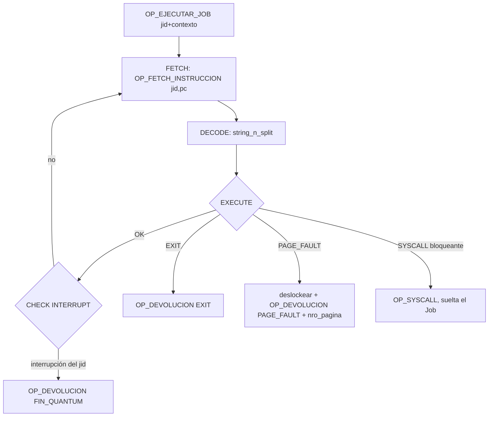

# Core

Volver a [[00 - Inicio]] · Depende de [[Utils]] y [[Protocolo]] · Habla con [[Planificador]] y [[Placa]]

Es el ejecutor de Jobs. Recibe un Job (`jid` + contexto) del Planificador y corre el ciclo **Fetch → Decode → Execute → Check Interrupt** pidiendo cada instrucción a la Placa. Traduce direcciones con su MMU y pide syscalls al Planificador. Puede haber N Cores, cada uno con un identificador propio.

**Ejecución:** `./bin/core [Archivo Config] [Identificador]` (configs de ejemplo: `core1.config`, `core2.config`)

## Estado
| Funcionalidad | `develop` | `origin/core` |
| --- | --- | --- |
| Conexión y handshake con Planificador y Placa | ✅ | ✅ (además recibe `OP_TAM_PAGINA` de la Placa) |
| NOOP, SET, SUM, SUB, JNZ, EXIT | ✅ | ✅ |
| INIT_JOB (no bloqueante) | ✅ | ✅ |
| Check Interrupt (fin de quantum, filtra por `jid`) | ✅ | ✅ |
| MMU: división en tramos por página, traducción, page fault | ❌ | ✅ |
| FORWARD / BACKWARD / UPDATE | ❌ | ✅ |
| LOAD_BATCH, LABEL, REPORT, SAVE/LOAD/DELETE_CHECKPOINT (envío) | ❌ | ✅ |
| **ALLOC / FREE** | ❌ | ⚠️ se parsean pero **no tienen `case`** en `ejecutar_instruccion` y caen en "Instrucción no reconocida" |

> [!bug] ALLOC/FREE en `origin/core`
> `parsear_operacion` devuelve `INST_ALLOC`/`INST_FREE` y existe `solicitar_syscall_con_parametro()` en `syscalls.c`, pero ningún `case` la llama. Hay que agregarlo antes del Check 3:
> 1. leer el registro del tamaño o de la dirección
> 2. `solicitar_syscall_con_parametro`
> 3. guardar `valor` en el registro destino (ALLOC)
> 4. `pc++`

## Ciclo de instrucción

---

## `main.c`
| Función | Descripción |
| --- | --- |
| `main` | `inicializar_core` → `conectar_con_modulos` → (rama) `mmu_init(tam_pagina)` → `atender_jobs_planificador` → `terminar_programa_core` |

## `utils.c` / `utils.h`
| Función / tipo | Descripción |
| --- | --- |
| `inicializar_core(t_config**, t_log**, path_config, identificador)` | Config y logger por Core |
| `terminar_programa_core(fd_plani, fd_placa, config, logger)` | Cierra los sockets y libera |
| `t_instruccion_tipo` | `NOOP, SET, SUM, SUB, JNZ, EXIT, INIT_JOB, INVALIDA` y en la rama además `FORWARD, BACKWARD, UPDATE, ALLOC, FREE, LOAD_BATCH, LABEL, REPORT, SAVE/LOAD/DELETE_CHECKPOINT` |
| `t_resultado_ejecucion` *(rama)* | `EJEC_OK, EJEC_EXIT, EJEC_PAGE_FAULT, EJEC_SYSCALL_BLOQUEANTE, EJEC_ERROR` |
| `t_tramo_pagina` *(rama)* | `{nro_pagina, desplazamiento, tamanio}` |
| `t_acceso_fisico` *(rama)* | `{direccion_fisica, tamanio}` |
| `t_resultado_mmu` / `t_resultado_marco` *(rama)* | `OK / PAGE_FAULT / ERROR` |

## `comunicacion.c` / `comunicacion.h`
| Función | Descripción |
| --- | --- |
| `crear_conexion_planificador` / `crear_conexion_placa` | `crear_conexion` con IP y puerto del config |
| `realizar_handshake(fd, identificador, modulo, logger)` | `handshake_cliente` como `MODULO_CORE` con `id_core` |
| `conectar_con_modulos(logger, config, id, &fd_plani, &fd_placa[, &tam_pagina])` | Conecta a los dos. En la rama además recibe `OP_TAM_PAGINA {uint32}` de la Placa |
| `solicitar_instruccion_a_placa(fd_placa, jid, pc, logger)` | `OP_FETCH_INSTRUCCION {jid, pc}` → `OP_RSP_FETCH {ok, string}`. Devuelve un `char*` que libera el caller |
| `enviar_devolucion_planificador(fd, jid, contexto, motivo, logger)` | `OP_DEVOLUCION {uint32 jid, uint8 motivo, contexto}` |
| `hay_interrupcion_pendiente(fd, jid_actual, logger)` | `recv` no bloqueante (`MSG_PEEK`) para ver si llegó `OP_INTERRUPCION`; descarta interrupciones de otro `jid`. Usa la bandera `interrupcion_guardada` si llegó mientras esperaba una respuesta de syscall |
| `interrupcion_es_del_job` *(static)* | Lee el `jid` de la interrupción y lo compara |
| `solicitar_init_job(fd, jid, contexto, archivo, logger)` | `OP_SYSCALL {INIT_JOB, jid, contexto, string archivo}` → espera `OP_RSP_SYSCALL`, guardando las interrupciones que lleguen en el medio |

## `ejecucion.c` / `ejecucion.h`
| Función | Descripción |
| --- | --- |
| `atender_jobs_planificador(logger, fd_plani, fd_placa)` | Loop: `OP_EJECUTAR_JOB` → deserializa jid+contexto → `ejecutar_ciclo_instruccion`. Descarta `OP_INTERRUPCION` si no hay un Job ejecutando |
| `ejecutar_ciclo_instruccion(jid, contexto, fd_plani, fd_placa, logger)` | Fetch/Decode/Execute/Check Interrupt hasta EXIT, desalojo, PF o syscall bloqueante. Devuelve `false` ante un error de comunicación |
| `ejecutar_entrenamiento(tipo, tokens, contexto, …)` *(rama)* | FORWARD/BACKWARD/UPDATE: traduce los rangos con la MMU, lee y escribe en la Placa y opera sobre los registros E1 a E3 |

## `instrucciones.c` / `instrucciones.h`
| Función | Descripción |
| --- | --- |
| `parsear_operacion(op)` | Texto → `t_instruccion_tipo` (sin distinguir mayúsculas en la rama) |
| `obtener_puntero_registro(nombre, contexto)` | `"PC"`, `"P0".."P5"`, `"AX".."DX"`, `"E1".."E3"` → `uint32_t*` o `NULL` |
| `obtener_valor_token(token, ctx, &valor)` | El token es un registro o un número decimal |
| `ejecutar_instruccion(…)` | En `develop` devuelve `bool` y marca `es_exit`. En la rama devuelve `t_resultado_ejecucion` y reporta `pagina_fault` |

## `mmu.c` / `mmu.h` *(solo `origin/core`)*
| Función | Descripción |
| --- | --- |
| `mmu_init(tam_pagina)` | Guarda el tamaño de página global |
| `mmu_dividir_rango(dir_logica, tamanio)` | Parte un rango lógico en `t_tramo_pagina` por página. No usa red, se puede testear sola |
| `mmu_traducir_rango(logger, fd_placa, jid, dir, tam, &accesos, &pagina_fault)` | Pide el marco de cada tramo. Ante un PF corta y devuelve `MMU_PAGE_FAULT` (las páginas anteriores quedan lockeadas) |
| `pedir_marco(fd_placa, logger, jid, nro_pagina, &marco)` | `OP_OBTENER_MARCO {jid, pagina}` → `OP_RSP_OBTENER_MARCO {ok, marco}` (`ok=false` es PF) |
| `deslockear_paginas(fd_placa, logger, jid)` | `OP_DESLOCKEAR_PAGINAS {jid}` → `OP_RSP_DESLOCKEAR_PAGINAS {ok}` |
| `devolver_por_page_fault(…, nro_pagina)` | Deslockea, loguea `## JID: <j> - Page Fault - Página: 
` y envía `OP_DEVOLUCION {jid, PAGE_FAULT, contexto, nro_pagina}` |
| `leer_accesos` / `escribir_accesos` | `OP_READ_MEM` / `OP_WRITE_MEM` por cada acceso físico |

## `syscalls.c` / `syscalls.h` *(solo `origin/core`)*
| Función | Descripción |
| --- | --- |
| `solicitar_syscall_con_parametro(fd, logger, jid, ctx, id, parametro, &ok, &valor)` | `{id, jid, ctx, uint32 parametro}` → espera `OP_RSP_SYSCALL`. Pensada para ALLOC/FREE, **sin uso todavía** |
| `ejecutar_syscall_memoria(id, nombre, reg_dir, reg_tam, ctx, …)` | Traduce el rango (si hay PF devuelve `EJEC_PAGE_FAULT` con el PC intacto), hace `pc++` y envía `{id, jid, ctx, [nombre], tamaño, cant_tramos, (dir, tam)*}`. Devuelve `EJEC_SYSCALL_BLOQUEANTE` |

## Configuración (`coreN.config`)
`LOG_LEVEL`, `IP_PLANIFICADOR`, `PUERTO_PLANIFICADOR` (8080), `IP_PLACA`, `PUERTO_PLACA` (8081)

## Registros (`t_contexto`)
`PC`, `P0`–`P5`, `AX`, `BX`, `CX`, `DX`, `E1`–`E3`: 14 registros `uint32`, en 0 al crear el Job. Ver [[Protocolo#Contexto de ejecución]].
