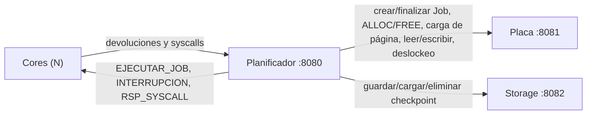
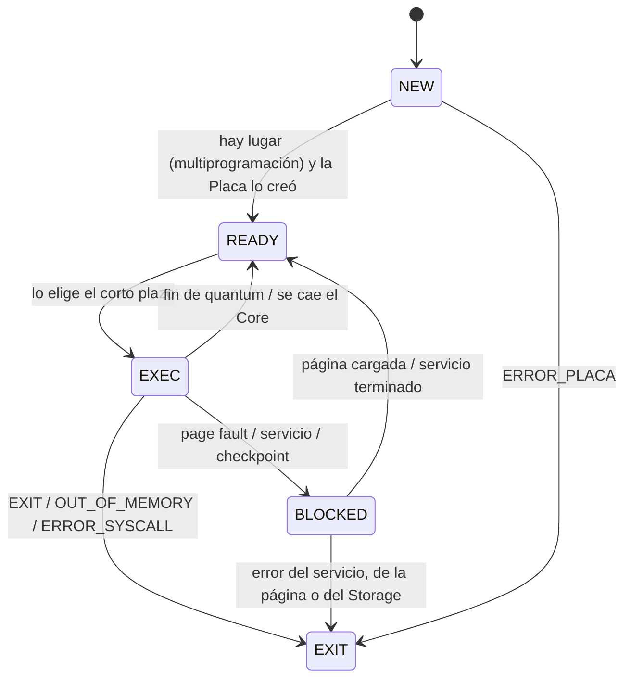

# Planificador: cómo funciona

Volver a [[00 - Inicio]] · Detalle función por función en [[Planificador]] · Mensajes en [[Protocolo]]

El Planificador es el "kernel" del TP:
- administra la cola de Jobs y decide qué Job ejecuta cada Core;
- atiende las syscalls y los page faults;
- corre los servicios (Loader, Labeler, Logger);
- persiste checkpoints a través del Storage.

No ejecuta instrucciones (eso lo hace el Core) ni guarda memoria (eso lo hace la Placa): **coordina**.

## 1. Arranque

```
./bin/planificador <config> <script del Job inicial>
```

1. **Config y logger.** Lee las 14 claves y valida que el algoritmo sea `FIFO`, `RR` o `HRRN`, que `GRADO_MULTIPROGRAMACION ≥ 1`, que `0 ≤ HRRN_ALFA ≤ 1` y que `ESTIMACION_INICIAL > 0`. Si falta algo, termina.
2. **Señales.** Bloquea SIGINT y SIGTERM, y lanza el hilo de cierre (Ctrl-C).
3. **Se conecta como cliente** a la Placa (`IP_PLACA:PUERTO_PLACA`) y al Storage (`IP_STORAGE:PUERTO_STORAGE`), con handshake. Si alguno no responde, **aborta**: por eso Placa y Storage arrancan antes.
4. **Abre su servidor** en `PUERTO_ESCUCHA` (8080) para los Cores.
5. **Crea el Job 0** con el script recibido. El script no lo lee el Planificador: solo le pasa el nombre a la Placa, que lo busca en su `PATH_INSTRUCCIONES`.
6. Lanza los hilos de servicios, de largo plazo y de corto plazo.

## 2. Con quién habla



| Con | Rol del Planificador | Socket | Protección |
| --- | --- | --- | --- |
| **Placa** | Cliente | Uno solo, compartido por todos los hilos | `mutex_placa`: pedido y respuesta van juntos |
| **Storage** | Cliente | Uno solo | `mutex_storage` |
| **Cores** | Servidor | Uno por Core, cada uno con su hilo | `mutex_socket` de cada Core |

### Qué le pide a la Placa
| Cuándo | Pedido | Respuesta | Si falla |
| --- | --- | --- | --- |
| Un Job entra a READY (largo plazo) | `OP_CREAR_JOB {jid, script}` | `{ok}` | El Job finaliza con `ERROR_PLACA` |
| Un Job finaliza | `OP_FINALIZAR_JOB {jid}` | `{ok}` | Se loguea el error |
| `ALLOC` | `OP_ASIGNAR_ESPACIO {jid, tamaño}` | `{ok, dir_lógica}` | El Job finaliza con `OUT_OF_MEMORY` |
| `FREE` | `OP_LIBERAR_ESPACIO {jid, dir}` | `{ok}` | Se le responde `false` al Core y el Job sigue |
| Page fault | `OP_CARGA_PAGINA {jid, página}` | `{ok}` | El Job finaliza con `ERROR_PAGE_FAULT` |
| Servicios y checkpoints | `OP_LEER_DATOS` / `OP_ESCRIBIR_DATOS` por tramo | `{ok[, bytes]}` | El Job finaliza con `ERROR_<SERVICIO>` |
| Fin de un servicio, o Core caído | `OP_DESLOCKEO_PAGINAS {jid}` | `{ok}` | Se loguea el error |

### Qué le pide al Storage
| Syscall | Pedido | Respuesta | Si falla |
| --- | --- | --- | --- |
| `SAVE_CHECKPOINT` | `OP_GUARDAR_CHECKPOINT {nombre, bytes}` | `{ok}` | `false`: `SIN_ESPACIO_STORAGE` |
| `LOAD_CHECKPOINT` | `OP_CARGAR_CHECKPOINT {nombre}` | `{ok, bytes}` | `false`: `CHECKPOINT_INEXISTENTE` |
| `DELETE_CHECKPOINT` | `OP_ELIMINAR_CHECKPOINT {nombre}` | `{ok}` | `false`: **solo se informa**, el Job sigue |
| Cualquiera, con el Storage caído | | | `ERROR_STORAGE`. No se reconecta |

### Qué intercambia con cada Core
| Sentido | Mensaje | Cuándo |
| --- | --- | --- |
| Core → P | `OP_HANDSHAKE {CORE, id}` | Al conectarse. Si ya hay un Core con ese ID, **se rechaza** (`HANDSHAKE_ERROR`) |
| P → Core | `OP_EJECUTAR_JOB {jid, contexto}` | El corto plazo despacha un Job |
| P → Core | `OP_INTERRUPCION {jid, FIN_QUANTUM}` | Vence el quantum (solo RR) |
| Core → P | `OP_DEVOLUCION {jid, motivo, contexto[, página]}` | Fin de quantum, page fault o `EXIT` |
| Core → P | `OP_SYSCALL {id, jid, contexto, parámetros}` | El Job pide una syscall |
| P → Core | `OP_RSP_SYSCALL {ok, valor}` | Solo en `INIT_JOB`, `ALLOC` y `FREE` |

## 3. Estados de un Job



Cada cambio se loguea: `## (3) Pasa del estado READY al estado EXEC`.

## 4. Planificación

### Largo plazo (un hilo)
Espera un Job en NEW (`sem_new`) y un lugar libre (`sem_multiprogramacion`, que arranca en `GRADO_MULTIPROGRAMACION`). Pide a la Placa que cree el Job y lo pasa a READY. Cuando un Job finaliza, libera su lugar.

### Corto plazo (un hilo)
Espera **un Job en READY y un Core libre** (`sem_ready` y `sem_cores_libres`). Elige según el algoritmo y despacha:

| Algoritmo | Elige | Desalojo |
| --- | --- | --- |
| FIFO | El primero que llegó a READY | No |
| RR | Igual que FIFO, y lanza un timer de `RR_QUANTUM` ms | Sí: al vencer, `OP_INTERRUPCION` |
| HRRN | Mayor `(W + S) / S` | No |

- **HRRN:** `W` es la espera en READY y `S` la ráfaga estimada. Al salir de EXEC, `S = α · ráfaga_real + (1 − α) · S`. Se loguea `## (N) - Prioridad HRRN calculada: … - Estimación próxima ráfaga: …`.
- **RR:** el timer guarda el ID del Core y el **número de despacho**. Si cuando vence el Job ya se fue, no interrumpe a nadie. Log: `## (N) - Desalojado por fin de quantum`.

## 5. Cómo responde a cada evento

### Devolución de un Core
Siempre guarda el contexto primero y libera el Core. Después:

| Motivo | Respuesta |
| --- | --- |
| `FIN_QUANTUM` | Log de desalojo → READY |
| `PAGE_FAULT` | Log `## (N) - Page Fault - Página: P` → BLOCKED → un hilo pide `OP_CARGA_PAGINA` → READY (la instrucción se reintenta) o `ERROR_PAGE_FAULT` |
| `EXIT` | Finaliza el Job con `EXIT` |

### Syscalls
Todas loguean `## (N) - Solicitó syscall: <NOMBRE>` y suman a las estadísticas.

| Syscall | ¿Bloquea? | Respuesta del Planificador |
| --- | --- | --- |
| `INIT_JOB` | No | Crea el Job en NEW y responde `{true, jid_nuevo}`. El Job que la pidió sigue en EXEC |
| `ALLOC` | No | OK: `{true, dir_lógica}`. Sin espacio: `{false, 0}` y finaliza el Job (`OUT_OF_MEMORY`); el Core lo abandona |
| `FREE` | No | `{true, 0}`, o `{false, 0}` si la dirección es inválida. El Job sigue |
| `LOAD_BATCH` · `LABEL` · `REPORT` | Sí | BLOCKED → cola del Loader, Labeler o Logger. No responde: el Core ya soltó el Job |
| `SAVE` · `LOAD` · `DELETE_CHECKPOINT` | Sí | BLOCKED → cola de Checkpoints → Storage |
| `EXIT` | — | Finaliza el Job |

### Servicios (un hilo y una cola FIFO cada uno)
El Core ya tradujo el rango y manda los **tramos físicos**, con las páginas lockeadas.

| Servicio | Qué hace |
| --- | --- |
| Loader | Lee el archivo de `PATH_DATOS` (si es corto, completa con ceros), espera `RETARDO_LOADER` y escribe por tramos |
| Labeler | `## (N) - Ingrese K caracteres:` → lee del teclado → escribe por tramos |
| Logger | Lee por tramos → hexadecimal → `## (N) - <HEX>` en `PATH_REPORTES` |
| Checkpoints | Lee o escribe por tramos y habla con el Storage |

Al terminar, **siempre deslockea** (también si falló) y el Job vuelve a READY, o finaliza con `ERROR_<SERVICIO>`.

### Cores que entran y salen
- **Entra un Core:** queda disponible al instante y el corto plazo empieza a usarlo. Si ya hay uno con ese ID, se rechaza.
- **Se cae un Core:** si tenía un Job en EXEC, el Planificador **deslockea sus páginas** y lo devuelve a READY con el último contexto. Otro Core lo retoma.
- **No queda ningún Core:** los Jobs esperan en READY hasta que se conecte uno.

### Fallas de los otros módulos
| Falla | Respuesta |
| --- | --- |
| No conecta a la Placa o al Storage al arrancar | Aborta |
| Se cae la Placa en ejecución | Cada pedido falla (`Se perdió la comunicación con la Placa`) y los Jobs afectados finalizan con error |
| Se cae el Storage en ejecución | Los checkpoints finalizan su Job con `ERROR_STORAGE`; el resto sigue |
| Ctrl-C | Loguea `Se recibió SIGINT: el módulo finaliza` y termina |

## 6. Al finalizar un Job
1. Pasa a EXIT y le pide a la Placa `OP_FINALIZAR_JOB`.
2. Loguea las estadísticas en una línea:
```
## (0) finalizó su ejecución con motivo de EXIT. Estadísticas: Tiempo total de ejecución: … - Tiempo para ingresar (NEW): … - Espera en READY: … - Memoria dinámica máxima: … - Syscalls: … - Page faults: … - Transiciones READY=>EXEC: …
```
3. Loguea el contexto final (`## (0) Contexto final: PC=… AX=… …`). No es obligatorio: sirve para validar los registros.
4. Libera su lugar de multiprogramación.

**Motivos posibles:** `EXIT`, `OUT_OF_MEMORY`, `ERROR_PLACA`, `ERROR_PAGE_FAULT`, `ERROR_LOADER`, `ERROR_LABELER`, `ERROR_LOGGER`, `ERROR_SYSCALL`, `SIN_ESPACIO_STORAGE`, `CHECKPOINT_INEXISTENTE`, `ERROR_STORAGE`.

## 7. Bugs a lo largo del desarrollo
Los que afectaron al Planificador, en orden. El registro completo de todos los módulos está en [[Bugs encontrados]].

| Cuándo | Bug | Qué causaba | Cómo se resolvió |
| --- | --- | --- | --- |
| 08/10 (Check 2) · `a27dd3e` | **Payloads incompatibles con el Core:** mandaba la interrupción como `{motivo, jid}` y leía la devolución como `{uint32 motivo, uint32 jid}`. El Core usa `{jid, motivo}` y `{uint32 jid, uint8 motivo}` | RR nunca desalojaba: el Core comparaba el motivo con el JID y descartaba todas las interrupciones. Las devoluciones se leían con el motivo y el JID cruzados | Se unificó el orden con el del Core. Desde entonces hay un solo header de protocolo para todos |
| 08/10 · `a27dd3e` | **No leía la confirmación de `OP_CREAR_JOB`** | La respuesta quedaba en el socket de la Placa y desfasaba el pedido siguiente (por ejemplo, la finalización) | Se lee `{ok}` en cada creación, y se agregó `creado_en_placa` para no finalizar en la Placa un Job que nunca se creó |
| 08/10 · `08eb85d` | **Opcode duplicado:** `OP_RSP_CREAR_JOB_PLACA` como copia local del de la rama `placa` | Dos nombres para el mismo valor podían desincronizarse sin que el compilador avisara | Después del merge se usa el del protocolo |
| 30/10 (Check 3) · `169c8a8` | **Un Core que se caía dejaba páginas lockeadas** | Esos marcos nunca más podían ser víctimas; con pocos marcos, los page faults no se resolvían | Al detectar la desconexión: `OP_DESLOCKEO_PAGINAS {jid}` y el Job vuelve a READY |
| 14/11 · `69c087f` (en el Core) | **Contrato de `ALLOC`/`FREE` rechazados:** el Core se desconectaba con un `FREE` inválido y devolvía con `EXIT` un Job ya finalizado por `ALLOC` | El Planificador perdía un Core, o recibía la devolución de un Job inexistente | Se acordó el contrato: `FREE` falso → el Job sigue; `ALLOC` falso → el Planificador finaliza el Job y el Core lo abandona sin devolverlo |
| 24/11 · `9793672` | **Ctrl-C sin cierre:** el proceso moría sin loguear nada | En los logs no quedaba por qué terminó | Hilo de cierre con `sigwait()`: loguea `Se recibió SIGINT` y termina. No se usa `exit()` porque se colgaba con el Labeler leyendo `stdin` |
| 27/11 · `d7dcf74` | **Dos Cores con el mismo ID** se registraban a la vez | El despacho y la interrupción podían ir al Core equivocado y un Job quedaba asignado a un Core que nunca lo recibía | El chequeo del ID, la respuesta del handshake y el alta van juntos bajo `mutex_cores`: el repetido se rechaza |
| 28/11 · sin commitear | **Warning falso del Job inicial** (`no es legible desde el Planificador`) y **`EXEC → BLOCKED` sin motivo** en el log | Un `[WARNING]` en todas las corridas correctas, y no se veía el page fault leyendo solo el log del Planificador | Se sacó el warning (el script lo lee la Placa) y se agregó `## (N) - Page Fault - Página: P` |

Además hubo problemas de concurrencia que se **previeron en el diseño** y nunca llegaron a ser bugs (ver [[Concurrencia y sincronización]]):
- **Respuestas cruzadas en el socket de la Placa:** se resolvió con pedido y respuesta bajo `mutex_placa`.
- **Interrupción tardía de un quantum vencido:** se resolvió con el número de despacho.
- **Contexto perdido:** se resolvió guardándolo siempre antes de mirar el motivo.

## 8. Conceptos de la materia aplicados

| Concepto | Dónde aparece en el Planificador |
| --- | --- |
| **PCB** | `t_proceso`: JID, estado, contexto de 14 registros, estimación, tiempos y contadores |
| **Diagrama de 5 estados** | NEW, READY, EXEC, BLOCKED y EXIT, con cada transición logueada |
| **Planificador de largo plazo y grado de multiprogramación** | Hilo de largo plazo + `sem_multiprogramacion`: admite Jobs solo si hay lugar |
| **Planificador de corto plazo** | Hilo de corto plazo: elige de READY y despacha a una CPU (Core) libre |
| **FIFO** (no expropiativo) | Orden de llegada a READY; puede tener efecto convoy |
| **Round Robin** (expropiativo) | Timer de `RR_QUANTUM` + interrupción; el Job desalojado vuelve al final de READY |
| **HRRN** (no expropiativo, sin inanición) | `(W + S) / S`: la espera W hace subir la prioridad de los Jobs largos (*aging*) |
| **Estimación de ráfagas** | Media exponencial: `S(n+1) = α · R(n) + (1 − α) · S(n)` |
| **Cambio de contexto** | El Core devuelve el contexto en cada devolución o syscall que bloquea; el Planificador lo guarda y lo reenvía en el próximo despacho |
| **Interrupciones** | `OP_INTERRUPCION` por fin de quantum; el Core la atiende en el Check Interrupt |
| **Syscalls y modo kernel** | Lo que el Core no puede resolver se lo pide al Planificador, que hace de kernel |
| **E/S bloqueante** | Los servicios bloquean al Job y liberan la CPU para otro, como un dispositivo de E/S |
| **Page fault y paginación bajo demanda** | El Planificador bloquea al Job, pide la carga de la página y lo devuelve a READY para reintentar la instrucción |
| **Bloqueo de páginas** | Deslockea al terminar cada servicio y cuando se cae un Core, como se liberan los buffers de E/S |
| **Multiprocesador** | N Cores ejecutando en paralelo, que entran y salen en cualquier momento |
| **Productor-consumidor** | Colas de NEW, READY y de cada servicio, con mutex + semáforo contador |
| **Exclusión mutua** | Un mutex por recurso compartido: colas, lista de Cores, socket de la Placa y del Storage, socket de cada Core |
| **Prevención de deadlock** | Orden fijo de locks (`mutex_cores` → `mutex_socket`) y ningún pedido a otro módulo con dos locks de socket tomados |
| **Sin espera activa** | Todo bloquea en semáforos, `accept`, `recv`, `getline` o `sigwait`: 0 % de CPU en reposo |
| **IPC por sockets, cliente-servidor** | Cliente de la Placa y del Storage, servidor de los Cores, con un protocolo serializado propio |
| **Señales** | SIGINT/SIGTERM bloqueadas en todos los hilos y atendidas por un hilo con `sigwait()` |

Más conceptos y preguntas probables en [[Teoría vs implementación]].

## 9. Decisiones de diseño

| Decisión | Alternativa descartada | Por qué |
| --- | --- | --- |
| Si un Core se cae con un Job en EXEC, el Job vuelve a **READY** con su último contexto y se deslockean sus páginas | Finalizar el Job con error | Que un Core se desconecte no es un error del Job; la prueba de estabilidad lo hace a propósito |
| Un solo socket con la Placa, con pedido y respuesta bajo `mutex_placa` | Un socket por hilo | Más simple y suficiente: el costo real son los retardos de la Placa. Evita respuestas cruzadas |
| El timer de quantum es un hilo por despacho y guarda ID del Core + número de despacho | Un único hilo reloj | Validar el número de despacho hace inofensiva una interrupción tardía |
| HRRN recalcula la estimación cada vez que el Job sale de EXEC | Solo al bloquearse | Toda ráfaga terminada aporta información sobre la próxima |
| Un hilo y una cola FIFO por servicio, más uno para Checkpoints | Un hilo por petición | El enunciado pide de a una petición por servicio; los distintos servicios sí corren en paralelo |
| El deslockeo se hace **siempre**, aunque el servicio falle | Finalizar sin deslockear | Las páginas lockeadas nunca serían víctimas y esos marcos se perderían |
| `ALLOC` sin espacio responde `false` y finaliza el Job; `FREE` inválido responde `false` y el Job sigue | Finalizar en los dos casos | Quedarse sin Offload compromete al Job; un `FREE` inválido no |
| En `ALLOC` rechazado, se responde al Core **antes** de liberarlo | Liberar primero | El Core está esperando la respuesta: si se liberara antes, podría recibir otro Job sin haber leído la respuesta |
| `DELETE_CHECKPOINT` de uno inexistente solo se informa | Finalizar el Job | Lo pide el enunciado |
| Directorio lleno y falta de espacio terminan los dos en `SIN_ESPACIO_STORAGE` | Un motivo por causa | El protocolo devuelve solo `ok`; el Storage loguea cada causa |
| Sin reconexión automática al Storage | Reintentar la conexión | Si se cae, el Job termina con `ERROR_STORAGE` sin colgar al Planificador; para seguir se repite la prueba |
| Un Core con un ID ya conectado se **rechaza** | Aceptarlo | Con dos IDs iguales se cruzan los despachos y las interrupciones |
| El contexto se guarda **siempre** apenas llega una devolución | Guardarlo según el motivo | Ningún camino puede perder el estado del Job |
| Tiempos con `CLOCK_MONOTONIC` | `time()` o `CLOCK_REALTIME` | No se ve afectado por cambios de hora; resolución de ms |

Las decisiones de los demás módulos están en [[Decisiones de diseño]].

## 10. Ejemplo real: prueba 01 FIFO en 4 máquinas (27/11)
Planificador en la .31, Placa en la .18, Storage en la .26 y Core 1 en la .25:

```
## Conectado a Placa exitosamente (192.168.1.18:8081)
## Conectado a Storage exitosamente (192.168.1.26:8082)
## (0) Se crea el Job - Estado: NEW
## (0) Pasa del estado NEW al estado READY
## Módulo: CORE
## (0) - Solicitó syscall: INIT_JOB          (crea los Jobs 1, 2 y 3)
## (1) - Solicitó syscall: ALLOC
## (1) Pasa del estado EXEC al estado BLOCKED    (page fault de la página 0)
## (1) Pasa del estado BLOCKED al estado READY
## (1) - Solicitó syscall: LOAD_BATCH
## (1) inicia Loader
## (1) - Escritura - Dirección Física: 0 - Tamaño: 8
## (1) - Deslockeo de páginas
## (1) finalizó Loader y pasa a READY
## (1) finalizó su ejecución con motivo de EXIT. Estadísticas: …
```

Los 4 Jobs terminaron en `EXIT`. Ver [[Laboratorio manual 2026-11-27]].
