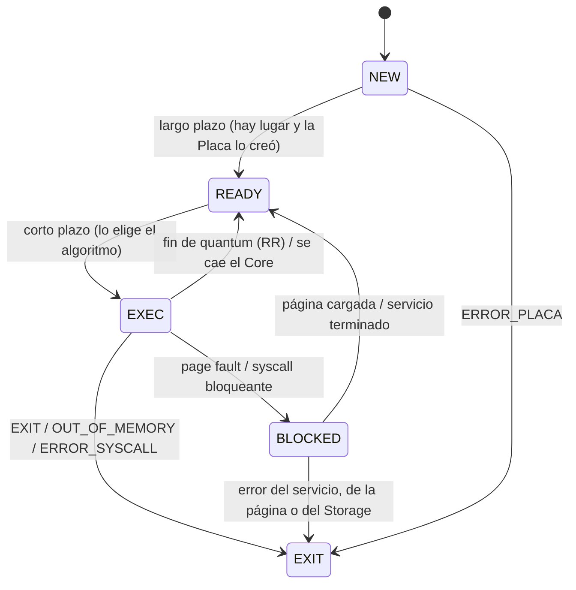

# Planificador: defensa para el coloquio

Volver a [[00 - Inicio]] · Detalle función por función en [[Planificador]] · Teoría en [[Teoría vs implementación]] · Concurrencia en [[Concurrencia y sincronización]]

> [!info] Cómo usar esta nota
> El coloquio es individual y evalúa que **la implementación no contradiga la teoría**. Esta nota tiene:
> 1. un **guion de 3 minutos** para presentar el módulo;
> 2. cada tema explicado con su **por qué teórico**;
> 3. las **trampas conceptuales** típicas;
> 4. las **preguntas probables** con su respuesta.
>
> Regla de oro: ante cada pregunta, responder **qué hace el TP**, **qué concepto de la teoría es** y **por qué lo hicimos así**.

---

## 1. Guion de 3 minutos

> El Planificador es el **kernel** del sistema. No ejecuta instrucciones (eso lo hacen los Cores, que son las CPUs) ni guarda memoria (eso lo hace la Placa): **decide** qué Job usa cada CPU y **atiende** lo que los Jobs no pueden hacer solos.
>
> Cada Job tiene un **PCB** (`t_proceso`): su contexto de 14 registros, su estado, su estimación de ráfaga y sus estadísticas. Los Jobs recorren el **diagrama de 5 estados**: NEW, READY, EXEC, BLOCKED y EXIT.
>
> Hay **dos planificadores**:
> - **El de largo plazo** decide cuándo un Job entra al sistema, respetando el **grado de multiprogramación**.
> - **El de corto plazo** decide qué Job de READY va a cada Core libre, con **FIFO, RR o HRRN** según la config.
>
> Cuando un Job necesita algo del sistema, hace una **syscall**:
> - Las que no bloquean (`INIT_JOB`, `ALLOC`, `FREE`) se responden en el momento y el Job sigue en EXEC.
> - Las que bloquean (`LOAD_BATCH`, `LABEL`, `REPORT` y los checkpoints) funcionan como **E/S**: el Job pasa a BLOCKED, el Core queda libre para otro, y un servicio atiende el pedido en su cola FIFO.
>
> Los **page faults** también bloquean: el Planificador le pide a la Placa que cargue la página y después devuelve el Job a READY para que **reintente la instrucción**.
>
> Todo corre en **hilos** que se comunican con **colas protegidas por mutex y semáforos**, sin espera activa. Los Cores pueden **entrar y salir en cualquier momento**: si uno se cae, su Job vuelve a READY y lo sigue otro.

---

## 2. Qué es y dónde está en el sistema

| Módulo | Analogía | Relación con el Planificador |
| --- | --- | --- |
| **Planificador** | Kernel | — |
| Core (1..N) | CPU | El Planificador es su **servidor**: le despacha Jobs, lo interrumpe y atiende sus syscalls |
| Placa | RAM + swap | El Planificador es su **cliente**: crea y finaliza Jobs, ALLOC/FREE, carga páginas, lee y escribe datos |
| Storage | Disco | El Planificador es su **cliente**: guarda, carga y elimina checkpoints |

**Arranque:**
```
./bin/planificador <config> <script del Job inicial>
```
1. Lee y valida la config.
2. Se conecta a la Placa y al Storage. Si alguno no está, aborta: por eso arrancan antes.
3. Abre el puerto 8080 para los Cores.
4. Crea el Job 0. El script no lo lee el Planificador: le pasa el nombre a la Placa.

> [!question] ¿Por qué el Planificador es cliente de la Placa y no al revés?
> Porque la Placa es un recurso pasivo, como la memoria: atiende pedidos y no toma decisiones. El que decide cuándo crear un Job o cargar una página es el kernel.

---

## 3. El PCB y el diagrama de estados

**`t_proceso`** es el PCB:
- identificación y estado: JID, estado, ruta del script;
- **contexto**: `PC`, `P0–P5`, `AX–DX` y `E1–E3`;
- planificación: estimación de ráfaga (HRRN) y momento de entrada al estado actual;
- estadísticas: tiempos en NEW y READY, syscalls, page faults, transiciones READY→EXEC y memoria dinámica máxima.



**Puntos para defender:**
- **No hay transición BLOCKED → EXEC.** Al terminar un bloqueo, el Job vuelve a READY y compite de nuevo. Es el modelo de 5 estados de la teoría.
- **`INIT_JOB`, `ALLOC` y `FREE` no pasan por BLOCKED.** Son syscalls que se resuelven al instante y el Core espera la respuesta: el Job sigue en EXEC.
- **El contexto se guarda siempre** apenas el Core devuelve el Job, antes de mirar el motivo. Es el **cambio de contexto**: sin eso, al volver a despacharlo se perdería dónde estaba.

---

## 4. Planificación de largo plazo

**Qué hace:** un hilo espera dos cosas: que haya un Job en NEW (`sem_new`) y que haya lugar (`sem_multiprogramacion`, inicializado en `GRADO_MULTIPROGRAMACION`). Cuando las tiene, pide a la Placa que cree las estructuras del Job y lo pasa a READY. Cuando un Job finaliza, libera su lugar (`sem_post`).

**Teoría:** es el **planificador de largo plazo**, que controla el **grado de multiprogramación**: cuántos procesos compiten a la vez por los recursos.

> [!warning] Trampa
> El grado de multiprogramación **no limita cuántos Jobs ejecutan** (eso lo limita la cantidad de Cores). Limita cuántos Jobs están **admitidos**: los que están en READY, EXEC y BLOCKED juntos. Con grado 4 y 2 Cores puede haber 2 en EXEC, 1 en READY y 1 en BLOCKED.

---

## 5. Planificación de corto plazo

**Qué hace:** un hilo espera **un Job en READY y un Core libre** (`sem_ready` y `sem_cores_libres`). Elige el Job según el algoritmo y se lo manda al Core con `OP_EJECUTAR_JOB {jid, contexto}`.

### FIFO
- Elige el que llegó primero a READY.
- **No expropiativo:** el Job ejecuta hasta que se bloquea o termina.
- **Desventaja teórica:** efecto convoy. Un Job largo hace esperar a todos los cortos.

### Round Robin
- FIFO + **quantum** (`RR_QUANTUM` ms). Al despachar se lanza un **timer**; si vence y el Job sigue en ese Core, se manda `OP_INTERRUPCION {jid, FIN_QUANTUM}`.
- El Core la atiende en el **Check Interrupt** (al final de la instrucción en curso) y devuelve el Job. Va al **final** de READY: `## (N) - Desalojado por fin de quantum`.
- **Expropiativo** por tiempo. Reparte la CPU de forma equitativa, a costa de más cambios de contexto.
- **Detalle de implementación clave:** el timer guarda el ID del Core y un **número de despacho**, que cambia cada vez que el Core recibe o suelta un Job. Si el Job se bloqueó antes de que venza el quantum, el número ya no coincide y **no se interrumpe** al Job siguiente. Además el Core descarta una interrupción cuyo JID no es el que ejecuta: doble protección contra la **condición de carrera**.

### HRRN (Highest Response Ratio Next)
- Elige el de mayor **response ratio**:

$$RR = (W + S) / S$$

  - **W:** cuánto lleva esperando en READY desde que entró la última vez.
  - **S:** la ráfaga **estimada**.
- **No expropiativo.**
- La estimación se actualiza **cada vez que el Job sale de EXEC** (por bloqueo, page fault o fin), con la media exponencial:

$$S(n+1) = α · R(n) + (1 − α) · S(n)$$

  - **R:** lo que realmente duró la ráfaga.
  - **α = `HRRN_ALFA`:** cuánto pesa la última ráfaga frente a la historia.
  - `S(0) = ESTIMACION_INICIAL`.
- Si hay empate, gana el primero de la cola (el que llegó antes).
- En cada elección se loguea la prioridad de cada candidato: `## (N) - Prioridad HRRN calculada: … - Estimación próxima ráfaga: …`.

**Ejemplo numérico** (α = 0,5 y `ESTIMACION_INICIAL` = 1000 ms):

| Job | Historia | S | W | RR = (W + S) / S |
| --- | --- | --- | --- | --- |
| A | Ejecutó 400 ms y se bloqueó; ahora espera | 0,5 · 400 + 0,5 · 1000 = **700** | 1400 | (1400 + 700) / 700 = **3,0** |
| B | Nuevo, nunca ejecutó | 1000 | 200 | (200 + 1000) / 1000 = **1,2** |

Se elige **A**: esperó mucho y además se estima corto. Si B sigue esperando, su W crece y su RR sube, hasta superar al de cualquier Job que recién llega. Por eso **HRRN no tiene inanición**: la espera funciona como *aging*.

> [!warning] Trampas de planificación
> - **HRRN no es expropiativo.** La estimación no interrumpe a nadie: solo se usa para elegir en READY.
> - **En HRRN no hay timer ni desalojo**, aunque la config tenga `RR_QUANTUM`.
> - **La ráfaga real es el tiempo en EXEC de esa vez.** Un `ALLOC` en el medio no la corta, porque el Job no sale de EXEC.
> - **En RR, una syscall bloqueante no es un desalojo:** el Job va a BLOCKED, no a READY, y no se loguea "Desalojado".

---

## 6. Syscalls: el Planificador como kernel

**Teoría:** una **syscall** es el pedido de un proceso al kernel por algo que no puede hacer en modo usuario. El Core no tiene acceso al sistema: se lo pide al Planificador con `OP_SYSCALL {id, jid, contexto, parámetros}`.

| Syscall | ¿Bloquea? | Qué hace el Planificador | Respuesta al Core |
| --- | --- | --- | --- |
| `INIT_JOB` | No | Crea un Job en NEW | `{true, jid_nuevo}` |
| `ALLOC` | No | Pide espacio a la Placa y anota la reserva | `{true, dir_lógica}`, o `{false}` y finaliza el Job (`OUT_OF_MEMORY`) |
| `FREE` | No | Libera en la Placa | `{true}`, o `{false}` y el Job sigue |
| `LOAD_BATCH` · `LABEL` · `REPORT` | **Sí** | BLOCKED → cola del servicio | Ninguna: el Core ya soltó el Job |
| `SAVE` · `LOAD` · `DELETE_CHECKPOINT` | **Sí** | BLOCKED → cola de Checkpoints → Storage | Ninguna |
| `EXIT` | — | Finaliza el Job | — |

> [!question] ¿Por qué algunas bloquean y otras no?
> Las que no bloquean son rápidas y el Core puede esperarlas. Las que bloquean tardan (el Loader espera `RETARDO_LOADER`, el Labeler espera al teclado, el Storage tiene retardos de disco): son **E/S**. Si el Core esperara, la CPU quedaría ociosa. Al bloquear, el Core queda libre para otro Job. Es exactamente por qué en la teoría un proceso que hace E/S pasa a bloqueado.

### Los servicios
Cada servicio tiene **un hilo y una cola FIFO**, y atiende de a una petición. Es un **productor-consumidor**: el hilo del Core produce peticiones y el hilo del servicio las consume.

| Servicio | Hace |
| --- | --- |
| Loader | Lee el archivo de `PATH_DATOS`, espera `RETARDO_LOADER` y escribe en la memoria del Job |
| Labeler | `## (N) - Ingrese K caracteres:` → lee del teclado → escribe |
| Logger | Lee de la memoria → hexadecimal → `PATH_REPORTES` |
| Checkpoints | Lee o escribe la memoria y habla con el Storage |

El Core manda los **tramos físicos** ya traducidos (dirección física + tamaño por página), y esas páginas quedan **lockeadas** en la Placa. Al terminar, el servicio **siempre deslockea**, aunque falle: si no, esos marcos nunca más podrían reemplazarse.

---

## 7. Page fault

1. El Core pide el marco de una página y la Placa responde que no está.
2. El Core devuelve el Job con `PAGE_FAULT`, la página y el contexto, **sin avanzar el PC**.
3. El Planificador loguea `## (N) - Page Fault - Página: P` y pasa el Job a **BLOCKED**.
4. Un hilo le pide a la Placa `OP_CARGA_PAGINA`. La Placa elige víctima si hace falta.
5. Si sale bien, el Job vuelve a **READY** y, al ejecutar, **reintenta la misma instrucción**. Si falla, finaliza con `ERROR_PAGE_FAULT`.

**Teoría:** paginación bajo demanda. El page fault **no es un error**: es la forma normal en que una página entra a memoria. Se bloquea porque traer una página del swap (el Offload) es E/S lenta.

> [!question] ¿Por qué el PC no avanza?
> Porque la instrucción no se ejecutó. Todas las traducciones se resuelven antes de tocar registros o memoria, así que la instrucción se repite entera cuando la página está.

---

## 8. Concurrencia

**Hilos del Planificador:** largo plazo, corto plazo, servidor de Cores, un hilo por Core conectado, un timer por despacho (RR), un hilo por page fault, uno por servicio (4) y el de cierre (Ctrl-C).

| Recurso compartido | Lo protege | Por qué |
| --- | --- | --- |
| Colas de NEW y READY, lista de Jobs | `mutex_new`, `mutex_ready`, `mutex_procesos` | Las tocan el largo plazo, el corto plazo y los hilos de los Cores |
| Cantidad de Jobs / Cores disponibles | `sem_new`, `sem_ready`, `sem_cores_libres`, `sem_multiprogramacion` | Semáforos contadores: el hilo **se bloquea** hasta que hay algo |
| Lista de Cores y su Job asignado | `mutex_cores` | La tocan el corto plazo, los timers y los hilos de los Cores |
| Socket de cada Core | `mutex_socket` del Core | Despacho, interrupción y respuesta de syscall salen de hilos distintos |
| Socket de la Placa | `mutex_placa` | **Pedido y respuesta van juntos**: si no, un hilo podría leer la respuesta de otro |
| Socket del Storage | `mutex_storage` | Lo mismo |
| Cola de cada servicio | `mutex_cola` + semáforo `pendientes` | Productor-consumidor |

**Problemas que el diseño evita:**
- **Condición de carrera en el socket de la Placa:** dos hilos mandan pedidos y cada uno lee la respuesta del otro → pedido y respuesta bajo el mismo mutex.
- **Interrupción tardía:** el quantum vence justo cuando el Job ya se fue → número de despacho.
- **Deadlock:** los locks se toman siempre en el mismo orden (`mutex_cores` → `mutex_socket`) y ningún pedido a otro módulo toma dos locks de socket a la vez. Sin espera circular, no hay deadlock.
- **Inanición:** FIFO y RR no tienen. En HRRN la evita el *aging* por W. Los servicios atienden en orden FIFO.
- **Espera activa:** no hay. Todos los hilos se bloquean en semáforos, `accept`, `recv`, `getline` o `sigwait`. Se midió: 0 % de CPU con el sistema en reposo.

> [!question] ¿Mutex o semáforo?
> El **mutex** da exclusión mutua: un solo hilo a la vez en la sección crítica. El **semáforo contador** cuenta recursos y bloquea al que pide cuando no hay. Las colas usan los dos: el mutex protege la lista y el semáforo cuenta cuántos elementos hay.

---

## 9. Robustez: Cores que entran y salen

- **Entra un Core:** handshake → si su ID ya está conectado, se rechaza; si no, queda libre y el corto plazo empieza a usarlo.
- **Se cae un Core** (Ctrl-C o `kill`): el `recv` de su hilo devuelve 0. Si tenía un Job en EXEC, el Planificador **deslockea sus páginas** y lo devuelve a **READY** con el último contexto guardado. Otro Core lo retoma.
- **No queda ningún Core:** los Jobs esperan en READY hasta que entre uno. No hay espera activa.
- **Se cae el Storage:** los checkpoints terminan con `ERROR_STORAGE` y el resto sigue. No se reconecta.
- **Ctrl-C:** un hilo dedicado recibe la señal con `sigwait()`, loguea y termina.

Probado en la prueba final 06: entraron y salieron Cores durante la corrida, con un Core cortado en medio de un `FORWARD`, y los 13 Jobs terminaron en `EXIT`.

---

## 10. Decisiones de diseño (y cómo defenderlas)

| Si te preguntan… | Respuesta |
| --- | --- |
| ¿Por qué un Core caído devuelve el Job a READY y no lo finaliza? | La falla es de la CPU, no del Job. Su contexto está guardado, así que puede seguir en otro Core. Antes hay que deslockear sus páginas |
| ¿Por qué un solo socket con la Placa? | Es suficiente: el costo real son los retardos de la Placa. El precio es serializar los pedidos con `mutex_placa`, y a cambio no hay respuestas cruzadas |
| ¿Por qué un timer por despacho? | Es simple y, con el número de despacho, una interrupción tardía es inofensiva |
| ¿Por qué la estimación se actualiza en toda salida de EXEC? | Toda ráfaga terminada da información sobre la próxima |
| ¿Por qué un hilo por servicio y no uno por petición? | El enunciado pide atender de a una por servicio; los distintos servicios sí van en paralelo |
| ¿Por qué deslockear aunque el servicio falle? | Una página lockeada nunca puede ser víctima: esos marcos se perderían para siempre |
| ¿Por qué `ALLOC` fallido finaliza el Job y `FREE` fallido no? | Sin Offload el Job no puede seguir; un `FREE` inválido no compromete su memoria |
| ¿Por qué se responde el `ALLOC` fallido antes de liberar el Core? | El Core está esperando esa respuesta: si se lo liberara antes, podría recibir otro Job sin haberla leído |
| ¿Por qué se rechaza un Core con ID repetido? | Con dos IDs iguales, el despacho y la interrupción podrían ir al Core equivocado |
| ¿Por qué `CLOCK_MONOTONIC`? | No lo afectan los cambios de hora del sistema |

Las decisiones de los demás módulos están en [[Decisiones de diseño]].

---

## 11. Bugs que tuvimos y qué aprendimos

| Bug | Qué causaba | Arreglo | Lección |
| --- | --- | --- | --- |
| Interrupción armada como `{motivo, jid}` cuando el Core leía `{jid, motivo}` (`a27dd3e`) | RR nunca desalojaba | Un solo orden, con un solo header de protocolo | El protocolo tiene que estar en un único lugar |
| No se leía la confirmación de `OP_CREAR_JOB` (`a27dd3e`) | La respuesta quedaba en el socket y desfasaba el pedido siguiente | Leer siempre la respuesta | En un socket compartido, todo pedido tiene que consumir su respuesta |
| Un Core caído dejaba páginas lockeadas (`169c8a8`) | Marcos perdidos para siempre | Deslockear al detectar la desconexión | Todo camino de salida libera los recursos |
| Dos Cores con el mismo ID (`d7dcf74`) | Despachos e interrupciones cruzados | Chequeo y alta atómicos bajo `mutex_cores` | Las operaciones "verificar y registrar" tienen que ser atómicas |
| Ctrl-C sin cierre (`9793672`) | No quedaba registro del fin | Hilo con `sigwait()` | Manejar las señales en un solo hilo |

El registro completo está en [[Bugs encontrados]].

---

## 12. Preguntas probables

**Planificación**
- **¿Qué diferencia hay entre el planificador de largo y el de corto plazo?** El de largo plazo admite Jobs al sistema según el grado de multiprogramación. El de corto plazo elige cuál de los admitidos (en READY) usa la CPU.
- **¿Qué algoritmo es expropiativo?** Solo RR, por quantum. FIFO y HRRN dejan ejecutar hasta que el Job se bloquea o termina.
- **¿HRRN puede tener inanición?** No: W crece mientras el Job espera, y su RR termina superando al de los demás.
- **¿Qué pasa con α = 1? ¿Y con α = 0?** Con α = 1, la estimación es solo la última ráfaga real. Con α = 0, nunca cambia: queda siempre `ESTIMACION_INICIAL`.
- **¿Qué pasa si vence el quantum cuando el Job ya se bloqueó?** El número de despacho no coincide y no se manda la interrupción. Si llegara igual, el Core la descarta porque el JID no es el que ejecuta.
- **¿Dónde va un Job desalojado por quantum?** Al final de READY, como dice RR.

**Syscalls y bloqueos**
- **¿Por qué `LOAD_BATCH` bloquea y `ALLOC` no?** `LOAD_BATCH` es E/S lenta; `ALLOC` se resuelve con un pedido rápido a la Placa.
- **¿Quién le responde al Core en una syscall bloqueante?** Nadie: el Core ya soltó el Job y quedó libre. Cuando el servicio termina, el Job vuelve a READY.
- **¿Por qué deslockea el Planificador y no el Core en los servicios?** Porque las páginas tienen que seguir lockeadas mientras el servicio escribe o lee en ellas, y eso pasa después de que el Core soltó el Job.

**Concurrencia**
- **¿Hay espera activa?** No. Todos los hilos se bloquean en primitivas del sistema operativo; se midió 0 % de CPU en reposo.
- **¿Puede haber deadlock?** No: los locks se toman en orden fijo y nunca se retienen dos sockets a la vez.
- **¿Por qué el corto plazo espera dos semáforos?** Para despachar hacen falta las dos cosas: un Job listo y una CPU libre.

**Robustez**
- **¿Qué pasa si se cae un Core con un Job en EXEC?** Se deslockean sus páginas y el Job vuelve a READY con su último contexto.
- **¿Y si se agregan Cores en medio de la ejecución?** Quedan disponibles al instante y el corto plazo empieza a usarlos.
- **¿Por qué hay que levantar la Placa y el Storage antes?** Porque el Planificador se conecta como cliente al arrancar y aborta si no están.

---

## 13. Estructuras de datos (preguntas y respuestas)

### Propias del Planificador

**¿Cuál es el PCB del TP?**
`t_proceso` (`planificacion.h`). Guarda todo lo que el sistema sabe de un Job:
- **Identidad y estado:** `pid` (el JID), `estado` (`t_estado`) y `path`, el script que carga la Placa.
- **Contexto:** `contexto` (`t_contexto`). Se guarda cada vez que el Core devuelve el Job y se reenvía en el próximo despacho.
- **`creado_en_placa`:** evita pedirle a la Placa que finalice un Job que nunca llegó a crear (por ejemplo, uno que terminó en `ERROR_PLACA`).
- **HRRN:** `estimacion_rafaga` (ms): arranca en `ESTIMACION_INICIAL` y se actualiza al salir de EXEC.
- **Tiempos** (`CLOCK_MONOTONIC`): `tiempo_creacion`, `tiempo_entrada_estado` y los acumulados en NEW y READY. Sirven para las estadísticas y para la `W` de HRRN.
- **Contadores:** `transiciones_ready_exec`, `cantidad_syscalls` y `cantidad_page_faults`.
- **Memoria dinámica:** `memoria_dinamica_actual`, `memoria_dinamica_maxima` y `reservas`.

**¿Para qué está `t_reserva` si la memoria la maneja la Placa?**
`t_reserva {direccion_logica, tamanio}` guarda cada `ALLOC` no liberado. La Placa administra la memoria, pero las estadísticas piden la **memoria dinámica máxima** del Job. El `FREE` solo trae la dirección, así que con las reservas el Planificador sabe cuánto restar.

**¿Qué es `t_estado`?**
`NEW`, `READY`, `EXEC`, `BLOCKED` y `EXIT`: el modelo de 5 estados de la teoría.

**¿Qué representa `t_core`?**
Una **CPU conectada** (`comunicacion.h`):
- `socket` e `id_core`, el que informa el Core en el handshake;
- `jid_asignado`: el Job que ejecuta, o `JID_LIBRE` (`UINT32_MAX`);
- `numero_despacho`: cambia en cada despacho y liberación;
- `hilo`: el hilo que lo atiende;
- `mutex_socket`: serializa los envíos (despacho, interrupción y respuesta de syscall).

**¿Por qué el timer de RR no guarda un puntero al Job?**
Porque cuando vence, el Job puede haberse bloqueado o terminado, y hasta pudo liberarse su struct. `t_quantum {id_core, numero_despacho}` (privado) guarda solo números. Si el número de despacho ya no coincide, el timer no hace nada.

**¿Qué son `t_page_fault` y `t_algoritmo`?**
Los dos son privados de `planificacion.c`:
- **`t_page_fault {proceso, nro_pagina}`:** el argumento del hilo que resuelve un page fault.
- **`t_algoritmo`:** `FIFO`, `RR` o `HRRN`, leído una sola vez de la config para no comparar strings en cada elección.

**¿Qué son `t_tramo` y `t_peticion`?**
Los dos están en `servicios.h`:
- **`t_tramo {direccion_fisica, tamanio}`:** un pedazo del rango que el Core ya tradujo. Nunca cruza una página.
- **`t_peticion`:** lo que se encola en un servicio:
  - `proceso`, `syscall` y `archivo` (el archivo de datos en `LOAD_BATCH`, el nombre en los checkpoints);
  - `tamanio` y `tramos`;
  - `motivo_error`: con qué motivo se finaliza el Job si falla.

**¿Qué es `t_servicio`?**
Un servicio como objeto (privado de `servicios.c`):
- `nombre` y `es_servicio`: en Checkpoints es `false`, porque no emite los logs de inicio y fin;
- `atender`: un **puntero a función** con la lógica de cada servicio;
- `cola`, `mutex_cola` y el semáforo `pendientes`: el productor-consumidor.

Hay 4 instancias estáticas: Loader, Labeler, Logger y Checkpoints. Un solo hilo genérico (`ejecutar_servicio`) sirve para los cuatro.

**¿Qué son `t_resultado_storage` y `t_alta_core`?**
- **`t_resultado_storage`:** `STORAGE_OK`, `STORAGE_RECHAZADO` (el Storage dijo `ok=false` → `SIN_ESPACIO_STORAGE` o `CHECKPOINT_INEXISTENTE`) o `STORAGE_SIN_CONEXION` (→ `ERROR_STORAGE`).
- **`t_alta_core`:** `ALTA_OK`, `ALTA_ID_REPETIDO` o `ALTA_SIN_RESPUESTA`, el resultado de registrar un Core.

**¿Para qué está `t_planificador`?**
Es el estado global del módulo (`main.h`):
- los argumentos, el `t_config` y el `t_log`;
- todas las claves de la config ya convertidas a su tipo;
- los sockets de la Placa, del Storage y del servidor.

Se carga una vez y después solo se lee.

### De `utils` (compartidas con los otros módulos)

**¿Qué es `t_contexto`?**
Los **14 registros** del Job: `pc`, `p0–p5`, `ax–dx` y `e1–e3`, todos `uint32`. Está en utils porque el Planificador, el Core y el protocolo tienen que serializarlo **igual**.

**¿Qué es `op_code`?**
El código de cada mensaje (1 byte en el socket), agrupado por rangos: `0x00` handshake, `0x10` Planificador→Placa, `0x30` Planificador→Storage, `0x40` Planificador↔Core y `0x60` Core→Placa.

**¿Qué son `t_modulo` y `handshake_msg`?**
`t_modulo` dice quién se conecta. `handshake_msg {modulo, id_core}` es lo primero que manda un cliente: con eso el Planificador rechaza lo que no sea un Core y obtiene su ID.

**¿Qué son `t_motivo_devolucion`, `t_motivo_interrupcion` y `t_syscall`?**
- **`t_motivo_devolucion`:** por qué el Core devuelve un Job: `FIN_QUANTUM`, `PAGE_FAULT`, `SYSCALL` o `EXIT`.
- **`t_motivo_interrupcion`:** hoy tiene un solo valor, `FIN_QUANTUM`.
- **`t_syscall`:** las 10 syscalls con número fijo, que es el `id` de `OP_SYSCALL`.

**¿Qué es `t_buffer`?**
El buffer de serialización:
- `stream`: los bytes;
- `size` y `capacidad`: crece solo al agregar datos;
- `offset`: por dónde va la lectura;
- `valido`: pasa a `false` si una lectura se pasa del final.

Un mensaje truncado se detecta con un solo `buffer_es_valido()` al final.

**¿Qué constantes trae el protocolo?**
`CANT_REGISTROS = 14`, `MAX_PAYLOAD_SIZE = 16 MiB` (un `size` absurdo se rechaza en lugar de reservar memoria) y `PROTOCOLO_ENTRENADOS_VERSION`.

### Colecciones y primitivas

**¿Qué colecciones usa?**
`t_list` de las commons:
- `procesos` (todos los Jobs), `cola_new` y `cola_ready`;
- `cores`;
- la cola de cada servicio;
- las `reservas` y los `tramos`.

`t_config` y `t_log` también son de las commons. Los mutex (`pthread_mutex_t`) y los semáforos (`sem_t`) son de POSIX.

**¿Dónde está la cola de BLOCKED? ¿Y la de EXEC?**
No hay una lista para cada uno, y es a propósito:
- un Job **bloqueado** está referenciado desde donde espera: la cola de un servicio (`t_peticion`) o el hilo de su page fault (`t_page_fault`);
- uno **en EXEC** se sabe por el `jid_asignado` de su `t_core`;
- **todos** están en `procesos`, para buscarlos por JID.

**¿Por qué las colas usan mutex y semáforo a la vez?**
El mutex protege la **lista** (exclusión mutua). El semáforo **cuenta** los elementos, para que el consumidor se bloquee sin espera activa. Por ejemplo, el corto plazo hace `sem_wait(sem_ready)` y recién ahí toma `mutex_ready` para sacar al Job.

---

## 14. Logs que conviene saber leer

| Log | Qué muestra |
| --- | --- |
| `## (N) Se crea el Job - Estado: NEW` | Creación (Job inicial o `INIT_JOB`) |
| `## (N) Pasa del estado A al estado B` | Cada transición del diagrama |
| `## (N) - Solicitó syscall: NOMBRE` | Llegó una syscall |
| `## (N) - Page Fault - Página: P` | Por qué pasa de EXEC a BLOCKED sin una syscall (no es obligatorio) |
| `## (N) - Desalojado por fin de quantum` | RR expropió la CPU |
| `## (N) - Prioridad HRRN calculada: … - Estimación próxima ráfaga: …` | Los candidatos que comparó HRRN |
| `## (N) inicia <Servicio>` / `## (N) finalizó <Servicio> y pasa a READY` | Inicio y fin de una E/S |
| `## (N) - Lectura/Escritura - Dirección Física: D - Tamaño: T` | Acceso a la memoria del Job desde un servicio |
| `## (N) - Deslockeo de páginas` | Se liberaron las páginas de un servicio |
| `## (N) finalizó su ejecución con motivo de M. Estadísticas: …` | Fin del Job: tiempo total, en NEW, en READY, memoria máxima, syscalls, page faults y transiciones READY→EXEC |

Ejemplo real de la prueba 01 FIFO en 4 máquinas en [[Laboratorio manual 2026-11-27]].
