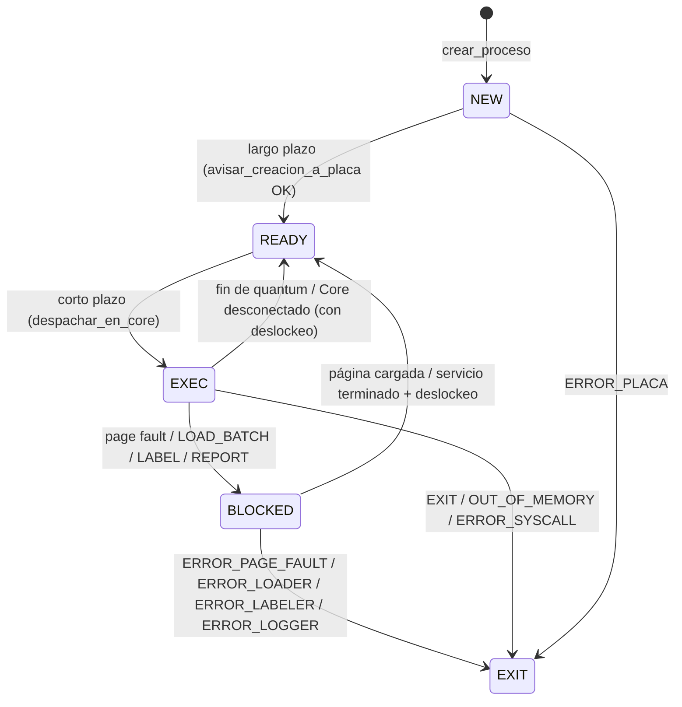

# Planificador

Volver a [[00 - Inicio]] · Depende de [[Utils]] y [[Protocolo]] · Habla con [[Core]], [[Placa]] y [[Storage]]

Administra la cola de Jobs del cluster. Se ocupa de:
- planificar a largo plazo (NEW→READY con grado de multiprogramación) y a corto plazo (FIFO, RR, HRRN)
- atender syscalls y page faults
- correr los servicios Loader/Labeler/Logger
- persistir checkpoints a través de Storage

**Ejecución:** `./bin/planificador [Archivo Config] [Path Job Inicial]`

## Estado
Rama `planificador` (`169c8a8`, pusheada el 30/10). Todavía no está en `develop`.

| Funcionalidad | Estado | Commit |
| --- | --- | --- |
| Conexión y handshake con Placa y Storage | ✅ | Check 1 |
| Servidor multihilo de Cores (conexión y desconexión en runtime) | ✅ | Check 1 |
| Largo plazo con `GRADO_MULTIPROGRAMACION` | ✅ | Check 2 |
| FIFO / RR (timer de quantum con número de despacho) / HRRN | ✅ | Check 2 · `85b58ff` |
| Syscalls `INIT_JOB`, `EXIT` | ✅ | Check 2 |
| Page fault / BLOCKED | ✅ | `0871672` |
| Syscalls `ALLOC`, `FREE` y memoria dinámica por Job | ✅ | `e5fd060` |
| Servicios Loader / Labeler / Logger (`LOAD_BATCH`, `LABEL`, `REPORT`) | ✅ | `42d562c` |
| Deslockeo al desconectarse un Core | ✅ | `169c8a8` |
| Estadísticas por Job (incluida la memoria dinámica máxima) | ✅ | |
| Checkpoints (`SAVE`/`LOAD`/`DELETE_CHECKPOINT`) | ❌ | Check 4 |

> [!success] Probado contra módulos simulados
> Las pruebas usaron Placa, Storage y Core simulados en Python, que hablan el protocolo real:
> - page fault, con carga OK y con error
> - `ALLOC`/`FREE`, incluido el caso sin Offload
> - los 3 servicios, con cola FIFO, tramos que cruzan páginas y stdin
> - desconexión de un Core
>
> Valgrind dio 0 bytes de fuga confirmada y ningún acceso inválido. **Falta** la prueba *Mini Entrenamiento* con la Placa y el Core reales (PRs #12 y #14).

## Modelo de estados



### Motivos de finalización
El enunciado no los define. Estos son los que elegimos:

| Motivo | Cuándo |
| --- | --- |
| `EXIT` | Instrucción EXIT |
| `ERROR_PLACA` | La Placa no pudo crear el Job |
| `ERROR_PAGE_FAULT` | La Placa no pudo cargar la página (o no se pudo crear el hilo) |
| `OUT_OF_MEMORY` | `ALLOC` sin espacio en el Offload |
| `ERROR_SYSCALL` | Syscall de servicio con payload malformado |
| `ERROR_LOADER` / `ERROR_LABELER` / `ERROR_LOGGER` | Falló el servicio (archivo inexistente, stdin cerrado, error de la Placa…) |
| `MOTIVO_NO_SOPORTADO` | Devolución con un motivo desconocido |

## Hilos
| Hilo | Función | Qué hace |
| --- | --- | --- |
| principal | `main` | Inicializa, conecta, crea el Job 0, inicia los servicios y espera al servidor de Cores |
| largo plazo | `planificar_largo_plazo` | `sem_new` + `sem_multiprogramacion` → crea el Job en la Placa → READY |
| corto plazo | `planificar_corto_plazo` | `sem_ready` → espera un Core libre → elige un Job según el algoritmo → despacha → en RR lanza el timer |
| servidor Cores | `atender_conexiones_de_cores` | `accept` en loop; un hilo por conexión |
| conexión entrante | `hilo_conexion_entrante` | Handshake; si es Core lo registra y entra a `atender_core` |
| timer de quantum | `contar_quantum` | Duerme `RR_QUANTUM` ms e interrumpe si el despacho sigue vigente (detached) |
| page fault | `resolver_page_fault` | Uno por PF (detached): pide la página a la Placa → READY o EXIT |
| Loader / Labeler / Logger | `ejecutar_servicio` | Uno por servicio: atiende su cola FIFO de a una petición |

## Sincronización
- `mutex_procesos`, `mutex_new` y `mutex_ready` protegen la lista global y las colas
- `sem_new` y `sem_ready` cuentan los Jobs disponibles en cada cola
- `sem_multiprogramacion` se inicializa en `GRADO_MULTIPROGRAMACION`; se libera en `finalizar_proceso`
- `mutex_placa`: **todo** pedido a la Placa pasa por `pedir_a_placa`, que envía y recibe sin soltar el lock. Así el largo plazo, los page faults y los servicios comparten el socket sin desfasar respuestas
- `mutex_cores` protege la lista de Cores; `sem_cores_libres` cuenta los Cores sin Job (`esperar_core_libre`)
- `t_core.mutex_socket` serializa los envíos a un Core (despacho, interrupción, respuesta de syscall)
- Cada servicio tiene su `mutex_cola` + semáforo `pendientes`
- `reservas` y `memoria_dinamica_*` de un Job las toca solo el hilo del Core que lo ejecuta (ALLOC/FREE no lo sacan de EXEC), así que no llevan mutex

---

## `main.c`
| Función | Firma | Descripción |
| --- | --- | --- |
| `main` | `int main(int argc, char* argv[])` | Valida los args → `cargar_config` → `inicializar_planificador` → `conectar_a_modulos` → servidor de Cores → `crear_proceso(job_inicial)` → `iniciar_servicios` → hilos de planificación → espera y limpia |
| `cargar_config` | `static bool cargar_config(void)` | Abre el config, crea el logger, exige las 14 claves y llena `t_planificador` |
| `validar_algoritmo` | `static bool validar_algoritmo(void)` | Acepta solo `FIFO`, `RR` o `HRRN` |

### `t_planificador` (`main.h`)
Es el estado global (`extern planificador`):
- args: `archivo_config`, `path_job_inicial`
- `config`, `logger`
- todas las claves del config tipadas
- sockets: `socket_placa`, `socket_storage`, `socket_servidor`

## `planificacion.c` / `planificacion.h`

### Tipos
- `t_estado`: `NEW`, `READY`, `EXEC`, `BLOCKED`, `EXIT`
- `t_proceso`:
  - identificación: `pid`, `estado`, `path`
  - `contexto`, `creado_en_placa`, `estimacion_rafaga`
  - tiempos: `tiempo_creacion`, `tiempo_entrada_estado`, `tiempo_acumulado_new/ready`
  - contadores: `transiciones_ready_exec`, `cantidad_syscalls`, `cantidad_page_faults`
  - memoria: `memoria_dinamica_actual`, `memoria_dinamica_maxima`, `reservas` (`t_list*` de `t_reserva`)
- `t_reserva`: `{direccion_logica, tamanio}` (lo asignado con ALLOC y no liberado)
- `t_algoritmo` (privado): `FIFO`, `RR`, `HRRN`
- `t_quantum` (privado): `{id_core, numero_despacho}`
- `t_page_fault` (privado): `{proceso, nro_pagina}`

### Funciones públicas
| Función | Firma | Descripción |
| --- | --- | --- |
| `inicializar_planificador` | `bool (void)` | Lee el algoritmo, crea las listas y colas e inicializa los semáforos |
| `iniciar_hilos_planificador` | `bool (void)` | Lanza los hilos de largo y corto plazo |
| `finalizar_planificador` | `void (void)` | Destruye las colas, los procesos y los semáforos |
| `crear_proceso` | `t_proceso* (const char* path)` | Asigna el PID, estado NEW, estimación inicial y lista de reservas vacía; log de creación; encola en NEW |
| `buscar_proceso` | `t_proceso* (uint32_t pid)` | Búsqueda lineal bajo `mutex_procesos` |
| `desalojar_por_fin_de_quantum` | `void (t_proceso*)` | Log de desalojo + `devolver_a_ready` |
| `devolver_a_ready` | `void (t_proceso*)` | Cambia a READY y encola |
| `bloquear_proceso` | `void (t_proceso*)` | → BLOCKED (log de cambio de estado; si venía de EXEC, recalcula la estimación HRRN) |
| `desbloquear_proceso` | `void (t_proceso*)` | BLOCKED → READY y encola |
| `atender_page_fault` | `void (t_proceso*, uint32_t nro_pagina)` | `cantidad_page_faults++` → BLOCKED → hilo `resolver_page_fault` |
| `finalizar_proceso` | `void (t_proceso*, const char* motivo)` | EXIT → `avisar_finalizacion_a_placa` → log de estadísticas → libera → `sem_post(multiprogramación)` |
| `registrar_syscall` | `void (t_proceso*, t_syscall)` | `cantidad_syscalls++` y log `Solicitó syscall` |
| `registrar_asignacion` | `void (t_proceso*, uint32_t dir, uint32_t tam)` | Agrega la reserva, suma a la memoria actual y actualiza el máximo |
| `registrar_liberacion` | `void (t_proceso*, uint32_t dir)` | Saca la reserva y descuenta su tamaño |
| `nombre_estado` | `const char* (t_estado)` | Pasa el enum a texto |
| `capturar_tiempo` | `uint64_t (void)` | ms con `CLOCK_MONOTONIC` |

### Funciones internas
| Función | Descripción |
| --- | --- |
| `leer_algoritmo` | Pasa `ALGORITMO_PLANIFICACION` a `t_algoritmo` |
| `encolar_new` / `sacar_de_new` | FIFO sobre `cola_new` con mutex y semáforo |
| `encolar_ready` | Agrega a `cola_ready` + `sem_post(sem_ready)` |
| `calcular_prioridad_hrrn` | `(W + S) / S`, con W = espera en READY y S = estimación (mínimo 1) |
| `indice_mayor_prioridad_hrrn` | Recorre READY, loguea la prioridad de cada Job y elige el máximo (ante empate, el primero que llegó) |
| `sacar_de_ready` | Saca el índice 0 (FIFO/RR) o el de mayor prioridad (HRRN) |
| `cambiar_estado` | Acumula tiempos de NEW/READY, cuenta READY→EXEC, **recalcula la estimación al salir de EXEC** (`α·real + (1−α)·anterior`) y loguea el cambio |
| `liberar_proceso` | `free` de las reservas, del path y del struct |
| `planificar_largo_plazo` | Hilo: NEW → crear en Placa → READY (si falla: `ERROR_PLACA`) |
| `lanzar_timer_de_quantum` | Crea el hilo `contar_quantum` detached |
| `planificar_corto_plazo` | Hilo: espera Job y Core → EXEC → despacha (si el Core se cayó, vuelve a READY) → timer si es RR |
| `resolver_page_fault` | Hilo: `cargar_pagina_en_placa` → `desbloquear_proceso`, o `finalizar_proceso(ERROR_PAGE_FAULT)` |
| `dormir_ms` | `nanosleep` que se reintenta si lo interrumpe una señal |
| `contar_quantum` | Duerme el quantum → `interrumpir_core_si_sigue_ocupado` |

## `comunicacion.c` / `comunicacion.h`

### `t_core`
```c
typedef struct {
    int socket;
    uint32_t id_core;            // informado en el handshake
    uint32_t jid_asignado;       // JID_LIBRE (UINT32_MAX) si está libre
    uint64_t numero_despacho;    // cambia en cada despacho y liberación
    pthread_t hilo;
    pthread_mutex_t mutex_socket;
} t_core;
```

### Cliente de la Placa
| Función | Pedido → respuesta | Notas |
| --- | --- | --- |
| `pedir_a_placa` *(static)* | genérico | Envío y recepción bajo `mutex_placa`; valida el opcode de respuesta y loguea si se perdió la conexión |
| `pedir_confirmacion_a_placa` *(static)* | genérico → `{bool ok}` | Para todas las respuestas que son solo ok |
| `avisar_creacion_a_placa` | `OP_CREAR_JOB {jid, path}` → `{ok}` | |
| `avisar_finalizacion_a_placa` | `OP_FINALIZAR_JOB {jid}` → `{ok}` | |
| `cargar_pagina_en_placa` | `OP_CARGA_PAGINA {jid, pagina}` → `{ok}` | Page fault |
| `asignar_espacio_en_placa` | `OP_ASIGNAR_ESPACIO {jid, tam}` → `{ok, dir_logica}` | ALLOC |
| `liberar_espacio_en_placa` | `OP_LIBERAR_ESPACIO {jid, dir}` → `{ok}` | FREE |
| `escribir_en_placa` | `OP_ESCRIBIR_DATOS {jid, dir_fisica, bytes}` → `{ok}` | Log `## (<JID>) - Escritura - Dirección Física: … - Tamaño: …` |
| `leer_de_placa` | `OP_LEER_DATOS {jid, dir_fisica, tam}` → `{ok, bytes}` | Log `Lectura`. Devuelve un `malloc` o `NULL` |
| `deslockear_paginas_en_placa` | `OP_DESLOCKEO_PAGINAS {jid}` → `{ok}` | Log `## (<JID>) - Deslockeo de páginas` |

### Cliente general
| Función | Descripción |
| --- | --- |
| `conectar_e_identificarse` *(static)* | `crear_conexion` + `handshake_cliente` como `MODULO_PLANIFICADOR` |
| `conectar_a_modulos` | Conecta a Placa y Storage; si falla, el `main` aborta |
| `desconectar_de_modulos` | Cierra ambos sockets |

### Servidor de Cores
| Función | Descripción |
| --- | --- |
| `inicializar_cores` | Crea la lista de Cores e inicializa `sem_cores_libres` |
| `iniciar_servidor_cores` | `crear_servidor(PUERTO_ESCUCHA)` |
| `inicializar_hilo_servidor_cores` / `esperar_hilo_servidor_cores` | Lanzan el hilo de `accept` y lo esperan con join |
| `atender_conexiones_de_cores` *(static)* | Loop de `esperar_cliente` → hilo `hilo_conexion_entrante` |
| `hilo_conexion_entrante` *(static)* | Recibe el handshake, loguea `## Módulo: …`, rechaza si no es Core, registra y atiende |
| `atender_core` *(static)* | Loop `recibir_buffer`: `OP_TEST`, `OP_DEVOLUCION`, `OP_SYSCALL`; si el Core se desconecta, `eliminar_core` |
| `manejar_test` *(static)* | Eco de la prueba de serialización del Check 1 |
| `registrar_core` *(static)* | Alta en la lista + `sem_post(sem_cores_libres)` |
| `eliminar_core` *(static)* | Baja. Si tenía un Job en EXEC: **deslockea sus páginas** y lo devuelve a READY |
| `buscar_core` *(static)* | Por `id_core` |
| `liberar_core` *(static)* | Si el Core ejecuta ese `pid`: lo marca libre, cambia `numero_despacho` y hace `sem_post(sem_cores_libres)` |
| `core_esta_ejecutando` *(static)* | Verifica `jid_asignado == pid` |
| `esperar_core_libre` | Bloquea hasta que haya un Core con `JID_LIBRE` y devuelve su id |
| `despachar_en_core` | Asigna el Job, incrementa `numero_despacho` y envía `OP_EJECUTAR_JOB {jid, contexto}` |
| `interrumpir_core_si_sigue_ocupado` | Si el despacho es el mismo, envía `OP_INTERRUPCION {uint32 jid, uint32 motivo}` |
| `recibir_devolucion` *(static)* | Lee `{jid, motivo, contexto[, nro_pagina si es PF]}`, guarda el contexto, libera el Core y actúa según el motivo: `FIN_QUANTUM`→READY, `PAGE_FAULT`→`atender_page_fault`, `EXIT`→EXIT, otro→`MOTIVO_NO_SOPORTADO` |
| `responder_syscall` *(static)* | `OP_RSP_SYSCALL {bool ok, uint32 valor}` |
| `recibir_syscall` *(static)* | Lee `{id, jid, contexto}`, valida que el Core ejecute ese Job, guarda el contexto, registra la syscall y la despacha (ver la tabla de abajo) |

### Atención de syscalls
| Syscall | Handler *(static)* | Comportamiento |
| --- | --- | --- |
| `INIT_JOB` | `crear_job_pedido` | `crear_proceso(path)` → responde `{true, jid_nuevo}`. El Job sigue en EXEC |
| `ALLOC` | `atender_alloc` | OK: `registrar_asignacion` y responde `{true, dir_logica}`. Sin espacio: responde `{false, 0}` **antes** de liberar el Core y finaliza el Job con `OUT_OF_MEMORY` |
| `FREE` | `atender_free` | OK: `registrar_liberacion` y responde `{true, 0}`. Dirección inválida: responde `{false, 0}` y el Job sigue |
| `LOAD_BATCH`, `LABEL`, `REPORT` | `atender_syscall_de_servicio` | `leer_peticion` → BLOCKED → `liberar_core` → `encolar_peticion`. Si viene malformada: `ERROR_SYSCALL`. **No hay respuesta** (el Core ya soltó el Job) |
| `EXIT` | — | `liberar_core` → `finalizar_proceso(EXIT)` |
| checkpoints | — | Responde "no soportada" (Check 4) |

## `servicios.c` / `servicios.h`

### Tipos
- `t_tramo`: `{direccion_fisica, tamanio}`. Es un tramo del rango ya traducido por el Core y nunca cruza una página
- `t_peticion`: `{proceso, archivo (solo LOAD_BATCH), tamanio, tramos}`
- `t_servicio` (privado): `{nombre, atender(), cola, mutex_cola, pendientes}`. Hay 3 instancias estáticas: `Loader`, `Labeler`, `Logger`

### Funciones
| Función | Descripción |
| --- | --- |
| `iniciar_servicios` | Crea la cola, el mutex, el semáforo y el hilo detached de cada servicio |
| `leer_peticion(syscall, proceso, buffer)` | Parsea `{[string archivo], tamaño, n, (dir, tam)×n}`. Devuelve `NULL` si está malformada o si la suma de los tramos no es igual al tamaño |
| `encolar_peticion(syscall, peticion)` | Agrega a la cola del servicio que corresponde y hace `sem_post` |
| `ejecutar_servicio` *(static)* | Hilo: saca de la cola FIFO → log `inicia <S>` → `atender()` → **deslockea siempre** → log `finalizó <S> y pasa a READY` + READY, o `ERROR_<S>` |
| `servicio_de` *(static)* | `LOAD_BATCH`→Loader, `LABEL`→Labeler, `REPORT`→Logger |
| `escribir_por_tramos` / `leer_por_tramos` *(static)* | Recorren los tramos en orden, con el offset acumulado |
| `atender_loader` *(static)* | Lee `tamaño` bytes de `PATH_DATOS/<archivo>` (si el archivo es más corto, completa con ceros y deja un warning) → `RETARDO_LOADER` → escribe por tramos |
| `atender_labeler` *(static)* | Log `## (<JID>) - Ingrese N caracteres:` → `getline` de stdin hasta juntar N (sobrantes descartados) → escribe por tramos. Es el único hilo que lee stdin |
| `atender_logger` *(static)* | Lee por tramos → pasa a hexadecimal en mayúsculas (`%02X`) → agrega `## (<JID>) - <HEX>` al final de `PATH_REPORTES` |
| `destruir_peticion` *(static)* | Libera los tramos, el archivo y la petición |

## Configuración (`planificador.config`)
| Clave | Ejemplo | Uso |
| --- | --- | --- |
| `PUERTO_ESCUCHA` | 8080 | servidor de Cores |
| `IP_PLACA` / `PUERTO_PLACA` | 127.0.0.1 / 8081 | cliente |
| `IP_STORAGE` / `PUERTO_STORAGE` | 127.0.0.1 / 8082 | cliente |
| `LOG_LEVEL` | INFO | |
| `ALGORITMO_PLANIFICACION` | FIFO \| RR \| HRRN | |
| `RR_QUANTUM` | 1500 | ms |
| `ESTIMACION_INICIAL` | 10000 | ms (HRRN) |
| `HRRN_ALFA` | 0.5 | |
| `GRADO_MULTIPROGRAMACION` | 4 | |
| `PATH_DATOS` | /home/utnso/datos/ | Loader (acepta la ruta con o sin `/` final) |
| `RETARDO_LOADER` | 500 | ms |
| `PATH_REPORTES` | /home/utnso/reportes.log | Logger (distinto del log del módulo) |
