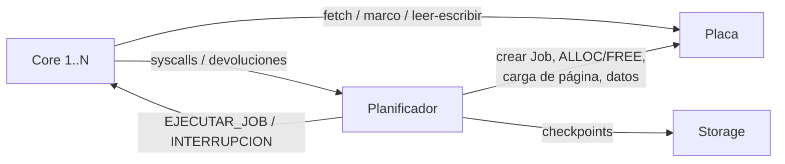
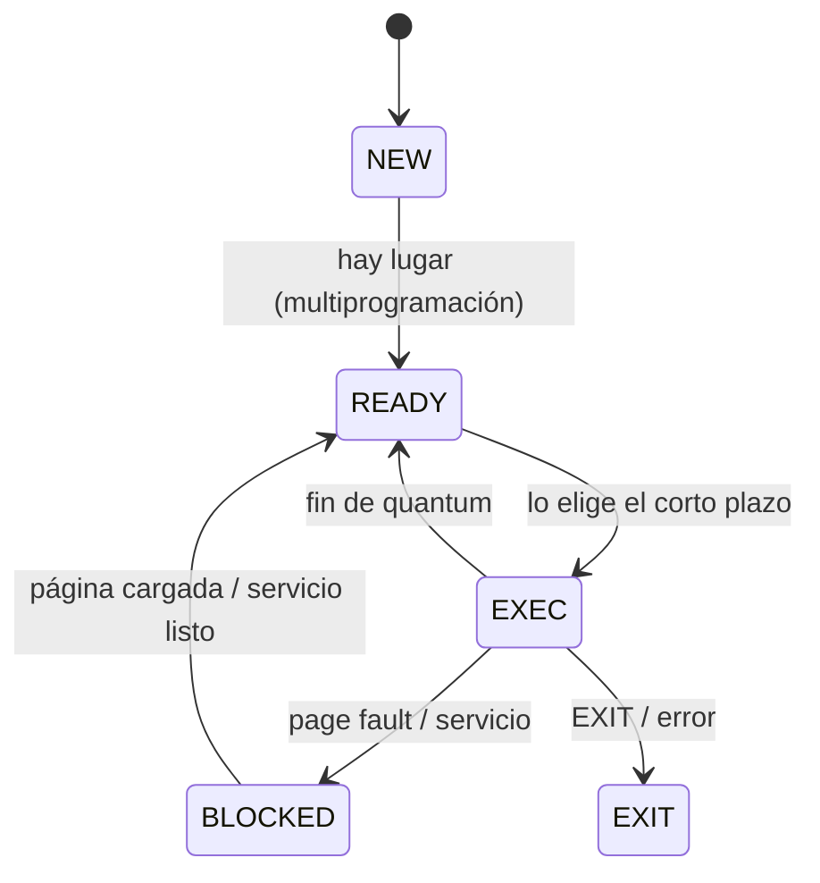
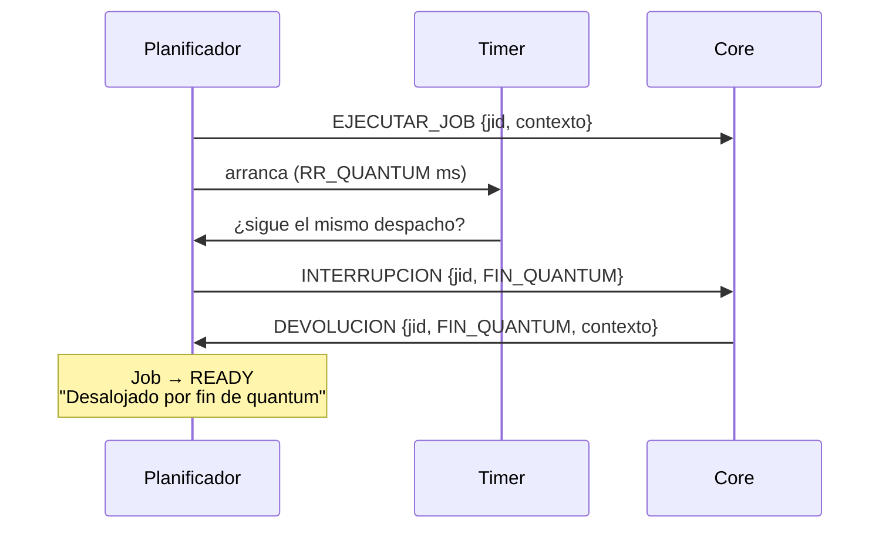
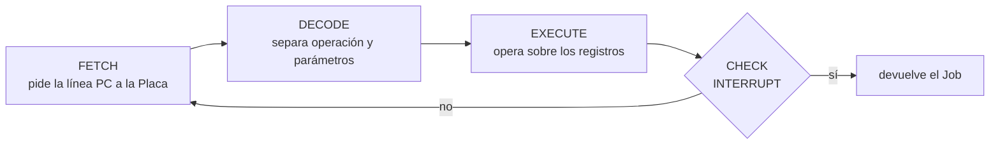
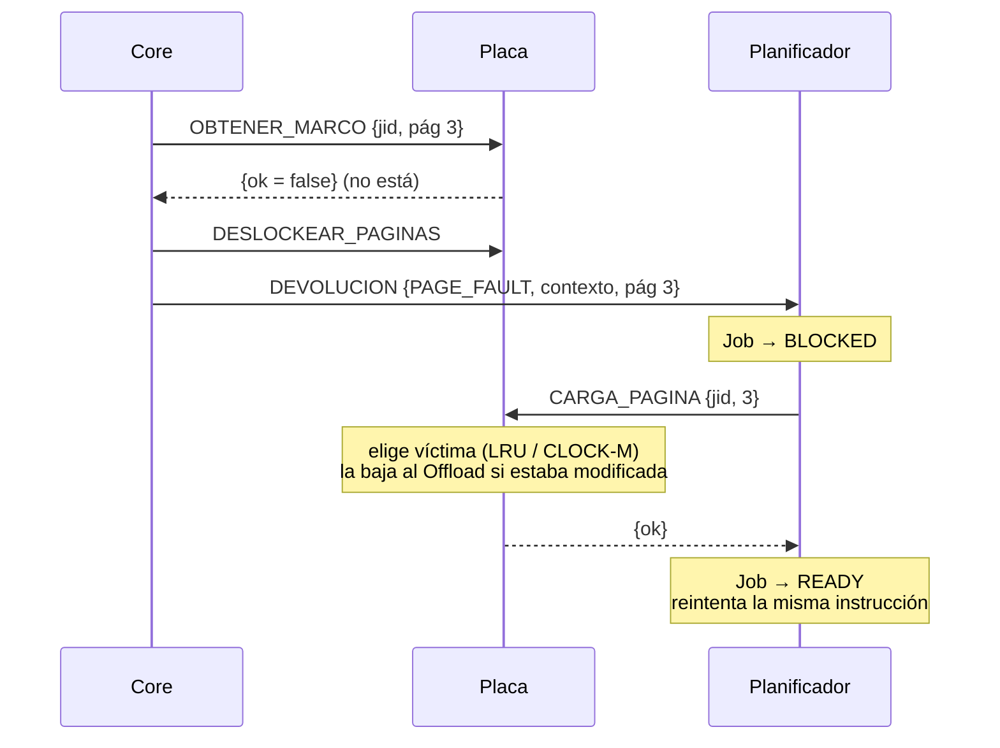

# EntrenadOS
## Cómo funciona el TP

Sistemas Operativos · 2C2026 · Grupo **RequiemSO**

Un cluster simulado que **planifica, ejecuta y persiste** Jobs de entrenamiento

---

## La idea en una frase

Un **Planificador** reparte Jobs entre varios **Cores**. Los Cores ejecutan las instrucciones que guarda la **Placa** (la memoria), y el **Storage** persiste los resultados como *checkpoints*.

| Módulo | Analogía |
| --- | --- |
| Planificador | El sistema operativo (kernel) |
| Core | Una CPU |
| Placa | La memoria RAM + el swap |
| Storage | El disco |

---

## Arquitectura



- 4 procesos independientes que se comunican **solo por sockets**
- Puede haber **N Cores**, que se conectan y desconectan en cualquier momento

---

## Orden de arranque

1. **Placa** y **Storage**: abren sus servidores
2. **Planificador**: se conecta a ambos y recién después abre su servidor
3. **Cores**: se conectan al Planificador y a la Placa

Cada conexión empieza con un **handshake**:

```
Core → Placa:  OP_HANDSHAKE {modulo = CORE, id_core = 1}
Placa → Core:  OP_HANDSHAKE_OK
Placa → Core:  OP_TAM_PAGINA {64}
```

---

## El protocolo

Un solo header compartido: `protocolo_entrenados.h`

**En el cable**, cada mensaje es:

```
| op_code (1 byte) | tamaño (4 bytes) | payload |
```

- El payload se arma con `t_buffer`, que agrega los datos uno detrás de otro (`uint32`, `string`, `bytes`, contexto)
- Los opcodes se agrupan por rangos: `0x10` P→Placa, `0x30` P→Storage, `0x40` P↔Core, `0x60` Core→Placa

> Ver [[Protocolo]] y [[Utils]]

---

## ¿Qué es un Job?

Un **archivo de pseudocódigo** más su **contexto de ejecución**:

```
SET AX 3
ALLOC P0 256
LOAD_BATCH lote1 P0 CX
FORWARD P0 P1 P2 BX
SUB AX 1
JNZ AX 3
REPORT P0 CX
EXIT
```

**Contexto**: 14 registros `uint32`
`PC` · `P0–P5` (punteros) · `AX–DX` (generales) · `E1–E3` (entrenamiento)

---

## Ciclo de vida de un Job



Cada transición queda en el log:
`## (3) Pasa del estado READY al estado EXEC`

---

## Planificación de largo plazo

- Todo Job nace en **NEW** (el inicial, o uno creado por `INIT_JOB`)
- Pasa a **READY** solo si hay lugar según `GRADO_MULTIPROGRAMACION`
- Al pasar, la Placa **crea sus estructuras** (instrucciones y tabla de páginas)
- Cuando un Job termina, libera su lugar → entra el siguiente de NEW

```
sem_multiprogramacion = GRADO_MULTIPROGRAMACION
NEW → (wait) → crear en Placa → READY
EXIT → (signal)
```

---

## Planificación de corto plazo

| Algoritmo | Cómo elige | Desalojo |
| --- | --- | --- |
| **FIFO** | El primero que llegó a READY | No |
| **RR** | FIFO + quantum (`RR_QUANTUM` ms) | Sí, por interrupción |
| **HRRN** | Mayor *Response Ratio* | No |

**HRRN:**

$$RR = \frac{W + S}{S} \qquad S_{n+1} = \alpha \cdot R_n + (1-\alpha) \cdot S_n$$

W = espera en READY · S = ráfaga estimada · R = ráfaga real

---

## RR: la interrupción por quantum



El **número de despacho** evita mandar una interrupción vieja a un Job nuevo

---

## El Core: ciclo de instrucción



- `SET`, `SUM`, `SUB`, `JNZ`, `NOOP`: solo registros
- `FORWARD`, `BACKWARD`, `UPDATE`: leen y escriben **memoria** del Job
- Syscalls: le piden algo al Planificador

---

## Instrucciones de entrenamiento

Simulan un paso de entrenamiento con aritmética sobre `uint32`

| Instrucción | Operación |
| --- | --- |
| `FORWARD P E S A` | `A = A + E1·E2` · `E3 = A` |
| `BACKWARD P Ac G A` | `A = A − E1·E2` · `E3 = A` |
| `UPDATE G Es P` | `E2 = (E2 + E1) / 2` · `E3 = E3 − E2` |

- `E1`, `E2` y `E3` se cargan **desde las direcciones** a las que apuntan los registros
- Se cargan solo los que la instrucción lee
- Al final, lo que se escribió vuelve a la memoria

---

## Memoria: paginación bajo demanda

- La memoria de la Placa se divide en **marcos** de `TAM_PAGINA`
- Cada Job tiene su **tabla de páginas**
- `ALLOC` reserva páginas, que arrancan **solo en el Offload** (el swap)
- Una página se trae a un marco recién cuando se usa

**La MMU del Core** traduce:

```
dirección lógica 200, TAM_PAGINA 64
→ página 3, desplazamiento 8
→ marco 7 → dirección física 7·64 + 8 = 456
```

Si un acceso cruza dos páginas, se parte en **tramos**

---

## Page Fault



---

## Reemplazo de páginas

Cuando no hay marcos libres, la Placa elige una **víctima**:

| Algoritmo | Criterio |
| --- | --- |
| **LRU** | La página que hace más tiempo no se usa |
| **CLOCK-M** | Recorre los marcos con un puntero buscando primero (uso=0, mod=0); si no encuentra, busca (0,1) y va apagando el bit de uso |

- Si la víctima estaba **modificada**, se escribe en el Offload antes de pisarla
- Las páginas **lockeadas** (en uso por un Core o un servicio) **nunca** son víctimas
- Por eso es clave **deslockear** al terminar

---

## Syscalls

| Syscall | ¿Bloquea? | Qué hace el Planificador |
| --- | --- | --- |
| `INIT_JOB archivo` | No | Crea un Job nuevo en NEW |
| `ALLOC reg tamaño` | No | Pide espacio a la Placa → devuelve la dirección lógica |
| `FREE reg` | No | Libera ese espacio |
| `LOAD_BATCH`, `LABEL`, `REPORT` | **Sí** | Servicios (siguiente diapositiva) |
| `SAVE` / `LOAD` / `DELETE_CHECKPOINT` | **Sí** | Habla con el Storage |
| `EXIT` | — | Finaliza el Job |

Las que **no bloquean**: el Core espera la respuesta y sigue.
Las que **bloquean**: el Core suelta el Job y queda libre para otro.

---

## Servicios del Planificador

Cada servicio tiene **un hilo** y **una cola FIFO**, y atiende de a una petición

| Servicio | Syscall | Qué hace |
| --- | --- | --- |
| **Loader** | `LOAD_BATCH` | Lee un archivo de `PATH_DATOS` y lo **escribe** en la memoria del Job |
| **Labeler** | `LABEL` | Pide N caracteres **por teclado** y los escribe |
| **Logger** | `REPORT` | **Lee** de memoria y lo guarda en hexadecimal en `PATH_REPORTES` |

```
BLOCKED → inicia Loader → escribe por tramos → deslockeo → READY
```

---

## Ejemplo: un servicio de punta a punta

`LOAD_BATCH lote1 P0 CX`, con `P0 = 0` y `CX = 100`

1. **Core**: la MMU traduce `[0, 100)` en 2 tramos (**las páginas quedan lockeadas**)
   `(dir 4, 60 bytes)` y `(dir 128, 40 bytes)`
2. **Core → Planificador**: `SYSCALL {LOAD_BATCH, "lote1", 100, tramos}` y suelta el Job
3. **Planificador**: Job → **BLOCKED** → cola del Loader
4. **Loader**: lee 100 bytes → espera `RETARDO_LOADER` → `ESCRIBIR_DATOS` por tramo
5. **Deslockeo** de páginas → Job → **READY**

```
## (0) inicia Loader
## (0) - Escritura - Dirección Física: 4 - Tamaño: 60
## (0) - Escritura - Dirección Física: 128 - Tamaño: 40
## (0) - Deslockeo de páginas
## (0) finalizó Loader y pasa a READY
```

---

## Storage: filesystem FAT32_TRAIN

Un archivo que simula un disco dividido en bloques:

```
| Superbloque | FAT | Directorio | Datos ... |
```

- **Superbloque**: firma `FAT32_TRAIN`, tamaño de bloque, cantidad de bloques
- **FAT**: una entrada por bloque, que **encadena** al bloque siguiente
- **Directorio**: entradas de 32 bytes `{estado, nombre, tamaño, bloque_inicial}`
- **Consola**: `INFO`, `LS`, `CAT`, `WRITE`, `RM`

Los **checkpoints** sobreviven a los Jobs y a los reinicios

---

## Checkpoints (Check 4)

| Syscall | Flujo |
| --- | --- |
| `SAVE_CHECKPOINT` | Leer la memoria del Job → Storage guarda → deslockeo → READY |
| `LOAD_CHECKPOINT` | Storage devuelve los datos → escribir en memoria → deslockeo → READY |
| `DELETE_CHECKPOINT` | Storage borra (si no existe, solo se informa) → READY |

- Sin espacio en el Storage, o checkpoint inexistente al cargar → el Job **finaliza**
- Un Job puede cargar el checkpoint que guardó **otro** Job

---

## Concurrencia: lo que no puede fallar

- **Un socket compartido** con la Placa → cada pedido y su respuesta van bajo `mutex_placa`
- **Timer de quantum** → valida el número de despacho antes de interrumpir
- **Contexto** → se guarda **siempre** apenas vuelve el Job
- **Páginas lockeadas** → se deslockean en **todo** camino de salida, también en errores
- **stdin** → solo lo lee el Labeler
- **Core que se cae** → su Job se deslockea y vuelve a READY

---

## Estadísticas al finalizar un Job

```
## (0) finalizó su ejecución con motivo de EXIT. Estadísticas:
  Tiempo total de ejecución: 1013 ms
  Tiempo para ingresar (NEW): 0 ms
  Espera en READY: 505 ms
  Memoria dinámica máxima: 4072 bytes
  Syscalls: 5 - Page faults: 2
  Transiciones READY=>EXEC: 5
```

Tiempos medidos con `CLOCK_MONOTONIC`

---

## Estado al 30/10

| Hito | Estado |
| --- | --- |
| Check 1: conexiones y serialización | ✅ |
| Check 2: FIFO / RR / HRRN | ✅ |
| Check 3: memoria, page fault, servicios | 🟡 Planificador ✅ (PR #15) · Core #12 · Placa #14 |
| Check 4: checkpoints | ⏳ 14/11 |
| Entregas | 28/11 · 12/12 · 19/12 |

> Ver [[Plan de acción]] y [[Estado de ramas]]

---

# ¿Preguntas?

[[00 - Inicio]] · [[Planificador]] · [[Core]] · [[Placa]] · [[Storage]] · [[Protocolo]]
