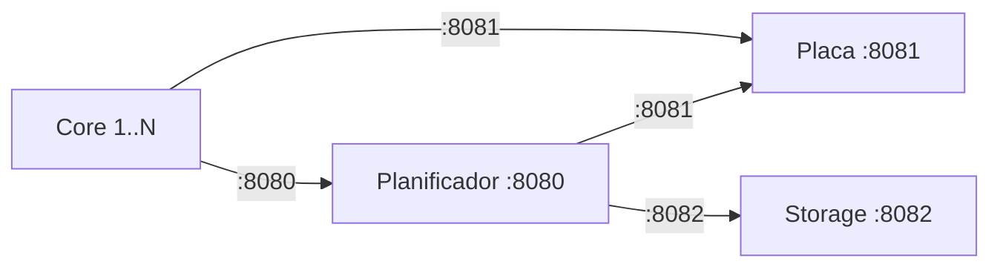
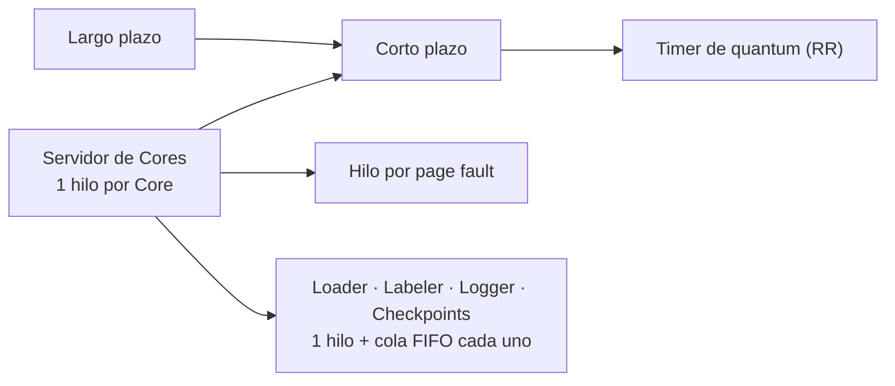
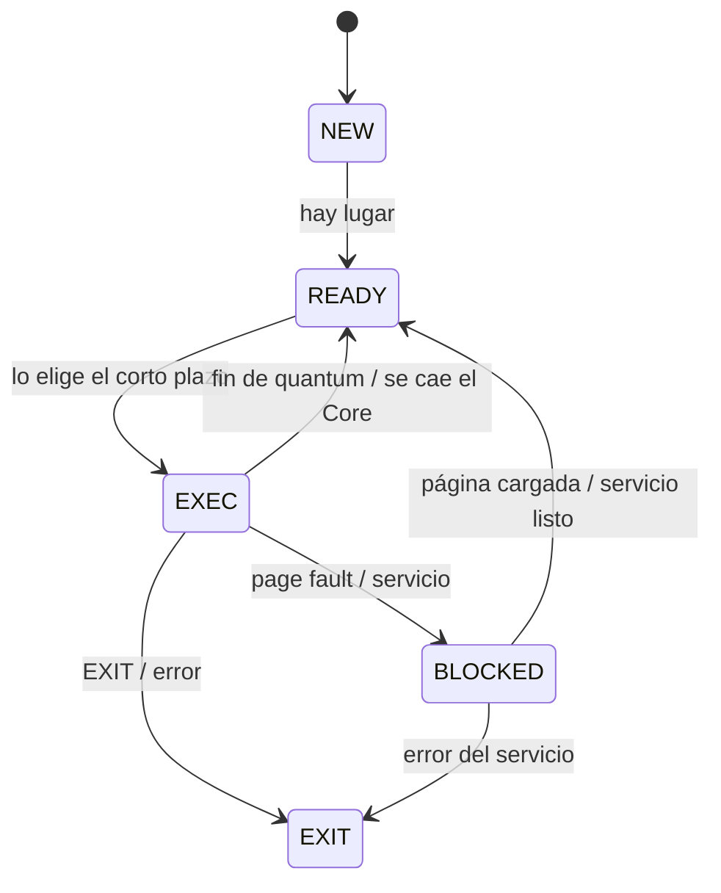
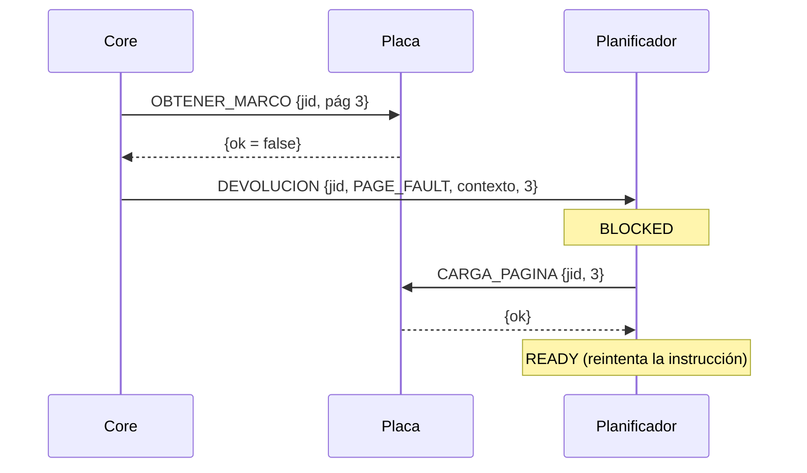
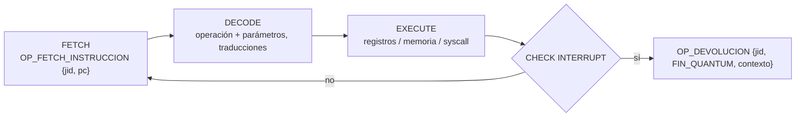

# EntrenadOS
## Cómo funciona el TP

Sistemas Operativos · 2C2026 · Grupo **RequiemSO**

Un cluster simulado que **planifica, ejecuta y persiste** Jobs de entrenamiento

1. Visión general · 2. Protocolo · 3. Planificador · 4. Core · 5. Placa · 6. Storage · 7. Cierre con Ctrl-C · 8. Deploy para la entrega final

---

## 1 · Qué simula el TP

Un **cluster dedicado a entrenar modelos de IA**. Los usuarios mandan **Jobs** de entrenamiento, que esperan en cola hasta que haya recursos.

Un Job repite muchas veces el mismo ciclo:
1. trae un **lote de datos** (`LOAD_BATCH`)
2. lo procesa **hacia adelante** por las capas del modelo (`FORWARD`)
3. recorre las capas **hacia atrás** calculando correcciones (`BACKWARD`)
4. **aplica** las correcciones al modelo (`UPDATE`)

Dos condiciones del entorno marcan el diseño:
- El espacio de trabajo de un Job suele ser **más grande que la memoria** de la Placa → paginación bajo demanda con Offload
- Un entrenamiento puede durar días → el Job **guarda su estado** (checkpoint) y lo retoma, incluso después de una caída

| Módulo | Rol | Analogía |
| --- | --- | --- |
| Planificador | Cola de Jobs, planificación, syscalls y servicios | Kernel |
| Core (1..N) | Ejecuta las instrucciones de los Jobs | CPU |
| Placa | Memoria de instrucciones y de usuario, con Offload | RAM + swap |
| Storage | Persiste los checkpoints (FAT32_TRAIN + journal) | Disco |

---

## 1 · Arquitectura

<!-- dibujo: arquitectura -->


- La flecha va del **cliente** al **servidor**: un módulo necesita que el otro ya esté levantado
- **Orden de arranque:** Placa y Storage → Planificador (se conecta a los dos y recién ahí abre su puerto) → Cores
- 4 procesos independientes que se comunican **solo por sockets**, en la misma máquina o en máquinas distintas
- Los Cores se pueden conectar y desconectar **en cualquier momento**

---

## 2 · Protocolo

Un solo header compartido: `utils/protocolo_entrenados.h` (la única fuente de verdad)

<!-- dibujo: trama -->
```
| op_code (uint8) | size (uint32, little endian) | payload (size bytes) |
```

- **`t_buffer`** arma el payload: agrega los datos uno detrás de otro y los lee en el mismo orden
  - `uint8`, `uint32`, `bool` · `string` = `uint32 largo` + bytes con `\0` · `bytes` = `uint32 tam` + datos · contexto = 14 × `uint32`
  - si una lectura se pasa del final, el buffer queda **inválido** (`buffer_es_valido`) y el mensaje se descarta
- **Handshake** al conectarse: `OP_HANDSHAKE {t_modulo, id_core}` → `OP_HANDSHAKE_OK` o `OP_HANDSHAKE_ERROR`
  - quien recibe loguea `## Módulo: <NOMBRE>`
  - después del handshake de un Core, la Placa le manda `OP_TAM_PAGINA {tam_pagina}` para su MMU
- Opcodes por rangos: `0x10` P→Placa · `0x30` P→Storage · `0x40` P↔Core · `0x60` Core→Placa

---

## 3 · Planificador: estructura

<!-- dibujo: hilos -->


| Hilo | Qué hace |
| --- | --- |
| **Largo plazo** | NEW → READY si hay lugar (`GRADO_MULTIPROGRAMACION`); crea el Job en la Placa |
| **Corto plazo** | Elige de READY con FIFO, RR o HRRN y despacha al Core libre |
| **Servidor de Cores** | Acepta Cores; un hilo por Core recibe devoluciones y syscalls |
| **Timer** | Uno por despacho en RR: al vencer, interrumpe si sigue el mismo despacho |
| **Page fault** | Uno por fault: pide `OP_CARGA_PAGINA` y vuelve el Job a READY |
| **Servicios** | Loader, Labeler, Logger y Checkpoints: un hilo y una cola FIFO cada uno |

Sincronización: mutex de NEW, READY y de la lista de Jobs · semáforos `sem_new`, `sem_ready` y `sem_multiprogramacion` · `mutex_placa` (pedido + respuesta) · `mutex_socket` por Core

---

## 3 · Planificador: estados de un Job

<!-- dibujo: estados -->


- Cada transición queda en el log: `## (3) Pasa del estado READY al estado EXEC`
- `INIT_JOB`, `ALLOC` y `FREE` no bloquean: el Job **sigue en EXEC** mientras el Core espera la respuesta
- El **contexto se guarda siempre** apenas vuelve el Job, antes de mirar el motivo
- Si el Core se cae con un Job en EXEC: deslockeo de sus páginas y el Job vuelve a **READY**

---

## 3 · Planificador: corto plazo

| Algoritmo | Cómo elige | Desalojo |
| --- | --- | --- |
| **FIFO** | El primero que llegó a READY | No |
| **RR** | FIFO + quantum de `RR_QUANTUM` ms | Sí: `OP_INTERRUPCION {jid, FIN_QUANTUM}` |
| **HRRN** | Mayor *Response Ratio* | No |

**HRRN**, con W = espera en READY, S = ráfaga estimada y R = ráfaga real:

$$RR = (W + S) / S$$

$$S(n+1) = α · R(n) + (1 − α) · S(n)$$

- `S(0) = ESTIMACION_INICIAL` · `α = HRRN_ALFA`
- La estimación se recalcula cada vez que el Job **sale de EXEC** y se loguea: `## (2) - Prioridad HRRN calculada: 1.84 - Estimación próxima ráfaga: 5012`
- RR: el timer guarda `id_core` + **número de despacho**; una interrupción vieja nunca desaloja al Job siguiente

---

## 3 · Planificador: page fault y syscalls

<!-- dibujo: page_fault -->


| Syscall | ¿Bloquea? | Qué hace el Planificador |
| --- | --- | --- |
| `INIT_JOB` | No | Crea un Job en NEW y responde su JID |
| `ALLOC` / `FREE` | No | `OP_ASIGNAR_ESPACIO` / `OP_LIBERAR_ESPACIO`; sin espacio → `OUT_OF_MEMORY` |
| `LOAD_BATCH` · `LABEL` · `REPORT` | **Sí** | Cola del Loader / Labeler / Logger |
| `SAVE` · `LOAD` · `DELETE_CHECKPOINT` | **Sí** | Cola de Checkpoints → Storage |
| `EXIT` | — | Finaliza el Job y lo saca de la Placa |

Log de cada una: `## (0) - Solicitó syscall: ALLOC`

---

## 3 · Planificador: servicios y checkpoints

El Core manda los **tramos físicos** ya traducidos (las páginas quedan **lockeadas**) y suelta el Job

| Servicio | Syscall | Qué hace |
| --- | --- | --- |
| **Loader** | `LOAD_BATCH` | Lee el archivo de `PATH_DATOS` (si es corto, completa con ceros), espera `RETARDO_LOADER` y **escribe** por tramos |
| **Labeler** | `LABEL` | `## (0) - Ingrese 8 caracteres:` → lee de **stdin** → escribe por tramos |
| **Logger** | `REPORT` | **Lee** por tramos → hexadecimal → `## (0) - 4C4F5445…` en `PATH_REPORTES` |
| **Checkpoints** | `SAVE` | Lee la memoria → `OP_GUARDAR_CHECKPOINT`; rechazado → `SIN_ESPACIO_STORAGE` |
| | `LOAD` | `OP_CARGAR_CHECKPOINT` → escribe en memoria; no existe → `CHECKPOINT_INEXISTENTE` |
| | `DELETE` | `OP_ELIMINAR_CHECKPOINT`; si no existe **solo se informa** |

```
BLOCKED → "inicia Loader" → escribe por tramos → deslockeo → "finalizó Loader y pasa a READY"
```

- **Deslockeo siempre**, también si el servicio falló (después el Job finaliza con `ERROR_LOADER`, `ERROR_LABELER`, …)
- Si se cae el Storage en medio de un pedido: el Job finaliza con `ERROR_STORAGE` y el Planificador sigue

---

## 3 · Planificador: estadísticas

Al finalizar cada Job se loguea una sola línea:

```
## (0) finalizó su ejecución con motivo de EXIT. Estadísticas:
  Tiempo total de ejecución: 1013 ms
  Tiempo para ingresar (NEW): 0 ms
  Espera en READY: 505 ms
  Memoria dinámica máxima: 4072 bytes
  Syscalls: 5 - Page faults: 2
  Transiciones READY=>EXEC: 5
```

- Tiempos con `CLOCK_MONOTONIC` (no se ven afectados por cambios de hora)
- La memoria dinámica máxima sale de las reservas vivas (`dirección → tamaño`) de cada Job
- Motivos posibles: `EXIT`, `OUT_OF_MEMORY`, `ERROR_PAGE_FAULT`, `ERROR_PLACA`, `ERROR_LOADER`, `ERROR_LABELER`, `ERROR_LOGGER`, `SIN_ESPACIO_STORAGE`, `CHECKPOINT_INEXISTENTE`, `ERROR_STORAGE`, `ERROR_SYSCALL`

---

## 4 · Core: ciclo de instrucción

<!-- dibujo: ciclo -->


- **Contexto**: 14 registros `uint32`: `PC` · `P0–P5` (punteros) · `AX–DX` (generales) · `E1–E3` (entrenamiento)
- El `PC` suma 1 al final, salvo que la instrucción lo haya cambiado (`JNZ`, `SET PC …`)
- Logs: `## JID: 0 - FETCH - Program Counter: 7` · `## JID: 0 - Ejecutando: FORWARD - P0 P1 P2 BX`

---

## 4 · Core: MMU y tramos

```
nro_pagina     = floor(dir_logica / TAM_PAGINA)
desplazamiento = dir_logica % TAM_PAGINA
dir_fisica     = marco · TAM_PAGINA + desplazamiento
```

<!-- dibujo: mmu -->
```
LOAD_BATCH con P1 = 100 y CX = 100, TAM_PAGINA = 64
lógica [100, 200) → pág 1 [100, 128) + pág 2 [128, 192) + pág 3 [192, 200)
tabla de páginas: pág 1 → marco 5 · pág 2 → marco 2 · pág 3 → marco 6
→ tramos físicos (dir_fisica, tamaño): (5·64 + 36 = 356, 28) · (2·64 = 128, 64) · (6·64 = 384, 8)
```

- Un acceso que cruza páginas se parte en **tramos** (uno por página)
- **Todas** las traducciones se resuelven **antes** de tocar memoria o registros
- `OP_OBTENER_MARCO` con `ok=false` → **page fault**: se deslockea lo obtenido y se devuelve el Job **sin avanzar el PC**
- Las páginas obtenidas quedan **lockeadas**; el Core las libera (`OP_DESLOCKEAR_PAGINAS`) al terminar la instrucción. En las syscalls con tramos las libera el Planificador

---

## 4 · Core: instrucciones e interrupciones

| Tipo | Instrucciones |
| --- | --- |
| Básicas | `NOOP` · `SET`, `SUM`, `SUB` (registro o número) · `JNZ reg instrucción` |
| Entrenamiento | `FORWARD Pesos Entrada Salida Acum`: `Acum = Acum + E1·E2` y `E3 = Acum` |
| | `BACKWARD Pesos Activ Grad Acum`: `Acum = Acum − E1·E2` y `E3 = Acum` |
| | `UPDATE Grad Estado Pesos`: `E2 = (E2 + E1) / 2` y `E3 = E3 − E2` |
| Syscalls que esperan respuesta | `INIT_JOB` · `ALLOC` (guarda la dirección en el registro) · `FREE` |
| Syscalls que sueltan el Job | `LOAD_BATCH` · `LABEL` · `REPORT` · `SAVE/LOAD/DELETE_CHECKPOINT` · `EXIT` |

- Entrenamiento: `E1–E3` se cargan **desde la memoria** a la que apuntan los registros, y lo que se escribió vuelve a memoria (`## JID: 0 - Acción: Escritura - Dirección Física: 456 - Tamaño: 4`)
- **Interrupción por quantum** (`## Interrupción recibida`):
  - el Check Interrupt lee el mensaje completo y lo **descarta si el `jid` no es el que ejecuta**
  - si llega mientras el Core espera la respuesta de una syscall, se **guarda** y se atiende en el siguiente Check Interrupt
- `ALLOC` rechazado: el Planificador ya finalizó el Job y el Core lo abandona. `FREE` rechazado: warning y sigue

---

## 5 · Placa: memoria

- **Memoria de instrucciones**: al crear el Job lee su archivo de `PATH_INSTRUCCIONES` (o la ruta absoluta) y guarda una lista de líneas por JID → `FETCH {jid, pc}` devuelve la línea `pc`
- **Memoria de usuario**: un bloque de `TAM_MEMORIA` bytes dividido en marcos de `TAM_PAGINA` (las dos potencias de 2)
- **Tabla de páginas** por Job:

| Campo | Para qué |
| --- | --- |
| `presente` · `marco` | Si está en memoria y en qué marco |
| `posicion_offload` · `respaldo_valido` | Su lugar en el Offload y si ya tiene una copia ahí |
| `uso` · `modificada` · `ultimo_acceso` | Bits de CLOCK-M y contador de LRU |
| `lockeada` | En uso por un Core o un servicio: no puede ser víctima |

- **`ALLOC`** reserva páginas y su espacio en el **Offload** (archivo `PATH_OFFLOAD` de `TAM_OFFLOAD` bytes); arrancan **no presentes**. Sin espacio en el Offload → la Placa responde `ok=false`
- `RETARDO_MEMORIA` antes de cada respuesta · `RETARDO_OFFLOAD` en cada lectura o escritura del Offload
- Logs: `## JID: 0 - Subida a Memoria - Página: 3 - Marco: 1` · `## JID: 0 - Bajada al Offload - Página: 5`

---

## 5 · Placa: reemplazo de páginas

Sin marcos libres, la Placa elige una **víctima** entre las páginas **no lockeadas**:

<!-- dibujo: clock -->
```
LRU:     la de menor ultimo_acceso (cada acceso suma un contador global)
CLOCK-M: puntero circular sobre los marcos, hasta 4 vueltas
  vuelta 1: busca (uso=0, mod=0) sin tocar bits
  vuelta 2: busca (uso=0, mod=1) y apaga el bit de uso de las que saltea
  vueltas 3 y 4: repite (ya con los bits de uso apagados)
```

- Si la víctima estaba **modificada** (o nunca se respaldó), se escribe en el Offload antes de pisarla
- Log: `## Reemplazo - Marco: 2 - JID Víctima: 1 - Página Víctima: 4`

---

## 5 · Placa: lockeo y consola

**Lockeo**
- `OP_OBTENER_MARCO` con `ok=true` **lockea** la página: así no la reemplazan mientras el Core la usa
- Se deslockea con `OP_DESLOCKEAR_PAGINAS {jid}` (Core, al terminar la instrucción) u `OP_DESLOCKEO_PAGINAS {jid}` (Planificador, al terminar un servicio o si se cae el Core)
- Si nunca se deslockea, esos marcos quedan fuera del reemplazo para siempre

**Consola** (stdin, "human-readable")

| Comando | Muestra |
| --- | --- |
| `INFO` | % de memoria y de Offload ocupados, marcos libres / lockeados / totales y cantidad de Jobs |
| `TLS` | Cada Job: JID, páginas residentes y páginas totales |

---

## 6 · Storage: volumen FAT32_TRAIN

<!-- dibujo: volumen -->
```
| bloque 0: superbloque | FAT (CANT_BLOQUES × 4 bytes) | directorio (BLOQUES_DIRECTORIO) | datos ... |
```

- `volumen.dat` y `journal.txt` en `PATH_STORAGE`; si no existe el volumen, se **formatea** al arrancar
- **Superbloque**: `"FAT32_TRAIN"` (11 bytes) · tamaño de bloque · cantidad de bloques · bloques del directorio (y padding con ceros)
- **FAT**: una entrada `uint32` por bloque que apunta al **siguiente** bloque del checkpoint
  - `0` libre · `0x0FFFFFFF` fin · `0x0FFFFFFE` reservado (superbloque, FAT y directorio)
- **Directorio**: entradas de 32 bytes `{estado (1), nombre (23), tamaño (4), bloque_inicial (4)}`
- `RETARDO_ACCESO_BLOQUE` en cada acceso a un bloque (datos, directorio o FAT)

---

## 6 · Storage: operaciones

| Operación | Qué hace | Error |
| --- | --- | --- |
| **Guardar** | Crea la entrada o reemplaza el contenido: reutiliza los bloques que tenía, pide los que faltan y libera los que sobran | `## ERROR - Directorio lleno…` / `## ERROR - Falta de espacio en FAT…` → el Job finaliza |
| **Cargar** | Recorre la cadena de la FAT y devuelve el contenido completo | No existe → el Job finaliza |
| **Eliminar** | Marca la entrada libre y libera toda la cadena en la FAT | No existe → solo se informa |

Logs:
- `## Solicitud Guardar Checkpoint: modelo` → `## Guardado Checkpoint: modelo - Tamaño: 60 completada`
- `## Acceso FAT - Entrada: 15 - Valor: 0x00000010` · `## Acceso Bloque - Checkpoint: modelo - Bloque: 15`

Los checkpoints **sobreviven** a los Jobs y a los reinicios: un Job puede cargar el que guardó otro

---

## 6 · Storage: journaling

Guardar y Eliminar se **asientan en el journal antes** de tocar el volumen

<!-- dibujo: journal -->
```
RECORD_STARTED 2 modelo
OP_DIR 3 1 modelo 60 0x0000000F
OP_FAT 0x0000000F 0x00000010
OP_FAT 0x00000010 0x0FFFFFFF
OP_WRITE 0x0000000F <hexa> · OP_WRITE 0x00000010 <hexa>
RECORD_COMMITED 2        ← fwrite + fflush + fsync (después de RETARDO_COMMIT)
(se aplica en el volumen)
RECORD_APPLIED 2
```

**Recuperación al arrancar**, recorriendo el journal en orden:

| Estado del asiento | Acción | Log |
| --- | --- | --- |
| Sin COMMIT (`kill -9` antes del commit) | Se descarta | `## Recuperación - Asiento: 2 - DESCARTADO` |
| COMMIT sin APPLIED (`kill -9` a mitad de la aplicación) | Se **re-aplica** completo | `## Recuperación - Asiento: 2 - APLICADO` |
| COMMIT y APPLIED | Se descarta | `## Recuperación - Asiento: 2 - DESCARTADO` |

- Cada modificación guarda el **valor final** (no un delta): re-aplicar es **idempotente**

---

## 6 · Storage: consola

| Comando | Qué hace |
| --- | --- |
| `INFO` | Contenido del superbloque |
| `LS` | Todas las entradas ocupadas del directorio, con sus atributos |
| `CAT <nombre> <bytes>` | Primeros bytes del checkpoint, en hexadecimal |
| `WRITE <nombre> <hexa>` | Crea o pisa un checkpoint con hasta 20 bytes (pasa por el journal) |
| `RM <nombre>` | Elimina el checkpoint (pasa por el journal) |

- La consola corre en su propio hilo con readline
- Ctrl-C / SIGTERM: deja de aceptar conexiones, cierra el volumen y loguea `Storage finalizado`

---

## 7 · Cierre con Ctrl-C: `utils/cierre`

Placa, Planificador y Core usan el mismo helper (el Storage tiene el suyo, `senales.c`)

<!-- dibujo: cierre -->
```
main: bloquear_senales_de_cierre()   ← antes de crear cualquier hilo
      iniciar_hilo_de_cierre(logger)
      ... hilos del módulo (heredan SIGINT/SIGTERM bloqueadas) ...
hilo de cierre: sigwait() → log "Se recibió SIGINT: el módulo finaliza"
                → SIG_DFL + raise(señal) → el proceso termina como con un Ctrl-C común
```

- Bloquearlas en todos los hilos evita que la señal corte un `accept()`, `recv()` o `usleep()` a mitad de camino
- ¿Por qué no `exit()`? Se colgaba: la consola de la Placa (o el Labeler) tiene tomado el lock de `stdin`
- ¿Por qué no `_exit()`? Bajo valgrind el proceso no terminaba si otro hilo leía de la terminal
- Verificado: los 4 módulos con 0 bytes *definitely lost* bajo valgrind

---

## 8 · Deploy: preparar las máquinas

En **cada** servidor (una sola vez):

```bash
sudo apt install -y tmux rsync
git clone https://github.com/sisoputnfrba/so-commons-library
cd so-commons-library && sudo make install && cd ..
git clone https://github.com/sisoputnfrba/entrenados-pruebas ~/entrenados-pruebas
git clone git@github.com:sisoputnfrba/tp-2026-2c-requiemso.git   # solo para --preparar
```

En la **máquina de control** (desde donde se lanzan las pruebas):

```bash
git clone git@github.com:sisoputnfrba/tp-2026-2c-requiemso.git && cd tp-2026-2c-requiemso
git checkout develop
git clone https://github.com/sisoputnfrba/entrenados-pruebas ~/entrenados-pruebas
ssh-keygen -t ed25519            # si no hay clave
ssh-copy-id utnso@192.168.1.25   # repetir para cada servidor (pide la contraseña una vez)
```

- `--preparar` hace `git fetch` en el clon de cada servidor y compila en `~/tp-run/src` (un worktree en `origin/develop`)
- Si los servidores no tienen acceso al repo privado: `--preparar-local` copia este checkout con `rsync` y compila allá

---

## 8 · Deploy: qué corre en cada máquina

<!-- dibujo: servidores -->
```
192.168.1.25 Placa · .26 Storage · .27 Planificador · .28 Core 1 (y 3) · .29 Core 2 (y 4)
```

| Archivo | Qué define |
| --- | --- |
| `deploy/servidores.conf` | Usuario SSH (`utnso`), clon del repo en cada servidor, `~/tp-run` como base, `REF=origin/develop`, lista de servidores |
| `deploy/catedra.conf` | Reparto: `PLACA`, `STORAGE`, `PLANIFICADOR`, `CORES_HOSTS` (core-1 al primero, core-2 al segundo, y se repite) |
| `deploy/catedra_entradas.conf` | Respuestas al Labeler y comandos de consola que piden las pruebas |

- Las configs de la cátedra se usan **tal cual**: solo se cambia `127.0.0.1` por la IP de cada servidor y las rutas relativas por absolutas
- Cada módulo corre en una sesión de **tmux** del servidor: `tp-placa`, `tp-storage`, `tp-planificador`, `tp-core-<id>`

---

## 8 · Deploy: las 6 pruebas finales

```bash
deploy/catedra.sh entregas_finales 01_planificacion/FIFO --preparar   # la primera vez del día
```

| Prueba | Cómo se corre | Qué se verifica |
| --- | --- | --- |
| 01 Planificación | `deploy/catedra.sh entregas_finales 01_planificacion/FIFO` (y `/RR`, `/HRRN`) | Orden de ejecución, desalojos por quantum, estimaciones HRRN |
| 02 Memoria | `deploy/catedra.sh entregas_finales 02_memoria/LRU` (y `/CLOCK-M`) | Víctimas, bajadas al Offload solo de las modificadas, reportes iguales |
| 03 Servicios | `deploy/catedra.sh entregas_finales 03_servicios` | Reportes = lote + texto del Labeler; Loader concurrente con el Labeler esperando |
| 04 Storage | `deploy/pruebas/finales/04_storage.sh` | Directorio lleno / falta de espacio, reutilización de bloques, `LS` tras reiniciar |
| 05 Journal | `deploy/pruebas/finales/05_journal.sh` | `kill -9` antes del COMMIT (descarta) y entre COMMIT y APPLIED (re-aplica) |
| 06 Estabilidad | `deploy/pruebas/finales/06_estabilidad.sh` | Cores que entran y salen durante la corrida; 13/13 Jobs en `EXIT` |

- Las respuestas al Labeler y los comandos de consola salen solos de `catedra_entradas.conf`
- `deploy/pruebas/finales/verificar_recursos.sh`: la 06 bajo valgrind + CPU en reposo (sin esperas activas)

---

## 8 · Deploy: cambiar el reparto en el momento

Las variables de `catedra.conf` se pisan desde el entorno, **sin editar nada**:

```bash
# todo en una sola máquina
PLACA=192.168.1.25 STORAGE=192.168.1.25 PLANIFICADOR=192.168.1.25 CORES_HOSTS="192.168.1.25" \
  deploy/catedra.sh entregas_finales 06_estabilidad

# los Cores repartidos en tres máquinas
CORES_HOSTS="192.168.1.27 192.168.1.28 192.168.1.29" deploy/catedra.sh entregas_finales 02_memoria/LRU
```

- Si en el servidor elegido falta el binario de un módulo, `catedra.sh` lo **compila** antes de lanzarlo
- `--cores "1 2"`: qué Cores arrancan al principio; los otros se levantan después (`--accion levantar core-3`)
- El reparto que pide cada prueba se respeta cambiando estas variables

---

## 8 · Deploy: checklist del día (< 10 minutos)

1. **IPs**: anotar las de las VMs del laboratorio y ponerlas en `deploy/catedra.conf` y `SERVIDORES` de `servidores.conf`
2. **Claves SSH**: `ssh-copy-id utnso@<ip>` en cada una y probar `ssh -o BatchMode=yes utnso@<ip> true`
3. **Código**: `git pull` en la máquina de control (rama `develop`)
4. **Compilar**: `deploy/catedra.sh entregas_finales 01_planificacion/FIFO --preparar` (o `--preparar-local`): despliega, compila y ya corre la primera prueba
5. **Prueba rápida**: si la 01 FIFO termina con los Jobs en `EXIT` y la verificación OK (unos 2 minutos), el entorno está listo
6. **Logs**:
   - en cada servidor: `~/tp-run/catedra/<suite>/<escenario>/` (y en vivo: `ssh -t utnso@<ip> tmux attach -t tp-planificador`)
   - en la máquina de control: `deploy/resultados/catedra-<suite>-<escenario>-<fecha>/`, con todos los logs y reportes juntos

---

## 8 · Deploy: si se cae una VM

1. **Cortar lo que quedó**: `deploy/catedra.sh entregas_finales <escenario> --accion detener`
2. **Ver qué responde**: `ssh -o ConnectTimeout=3 utnso@<ip> true` en cada servidor
3. **Mover el módulo** a otra VM con las variables de entorno (por ejemplo `STORAGE=192.168.1.27`) y volver a correr el escenario: si falta el binario, se compila solo
4. **Cuando la VM vuelve**: `tmux ls` para ver si quedaron sesiones viejas, y `--preparar` de nuevo si se reinstaló

| Qué se cayó | Qué pasa en el TP |
| --- | --- |
| Un **Core** | El Planificador deslockea las páginas del Job y lo vuelve a READY; los otros Cores siguen |
| El **Storage** | Cada checkpoint pedido desde ese momento finaliza su Job con `ERROR_STORAGE` (el Planificador no se reconecta): hay que repetir el escenario. Al volver, el journal recupera el volumen |
| La **Placa** o el **Planificador** | Se corta la prueba: hay que repetir el escenario completo |

---

# ¿Preguntas?

[[00 - Inicio]] · [[Planificador]] · [[Core]] · [[Placa]] · [[Storage]] · [[Protocolo]] · [[Despliegue distribuido]] · [[Bugs encontrados]]
