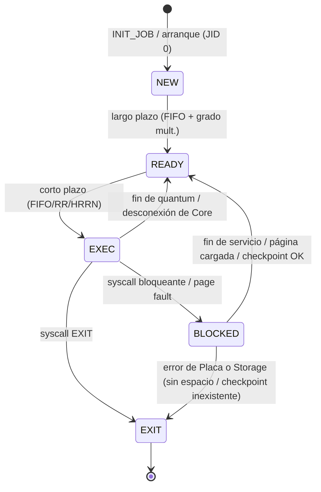

# Plan de implementación — Módulo Planificador (TP EntrenadOS)

Plan de procedimiento paso a paso para implementar el módulo **Planificador** del [[TP Sistemas Operativos 2C2026 - EntrenadOS]], alineado a los checkpoints del [[tp-so-2c2026-entrenados-trello|Tablero Trello EntrenadOS]] y con la [[Código fuente TP RequiemSO (Plug & Pray)|base de código del TP anterior (RequiemSO)]] como punto de partida. Fuente primaria: enunciado EntrenadOS v1.0 (capturado en `.raw/captured/d8952c1f…`).

## 1. Contexto y objetivo

- **Invocación:** `./bin/planificador [Archivo Config] [Path Job Inicial]` — el Job Inicial es el **JID 0**; los demás Jobs nacen por syscall `INIT_JOB`.
- **Rol:** administrar la cola de Jobs del cluster, planificar a largo y corto plazo, atender syscalls y page faults, correr 3 servicios (Loader/Labeler/Logger) y persistir checkpoints vía Storage.
- **Conexiones:** **cliente** de Placa y Storage al iniciar; después **servidor multihilo** para Cores, con escucha permanente (los Cores pueden conectarse y desconectarse en cualquier momento).
- **Modelo de 5 estados:** NEW, READY, EXEC, BLOCKED, EXIT.

### Hitos y fechas

| Hito | Fecha | Alcance para el Planificador | Fase |
| --- | --- | --- | --- |
| Check 1 · Conexiones y Serialización | **12/09** | Servidor multihilo, handshakes, serialización sin cuelgues | Fase 0 |
| Check 2 · Planificación y Ejecución Básica | **10/10** | Cola Jobs, context switch FIFO y RR, quantums en logs | Fases 1-2 |
| Check 3 · Memoria, Paginación y Servicios | **31/10** | Page faults, syscalls, servicios bloqueantes, BLOCKED | Fases 3-5 |
| Check 4 · Storage y Persistencia | **14/11** | SAVE/LOAD/DELETE_CHECKPOINT con Storage | Fase 6 |
| Entregas finales | 28/11 · 12/12 · 19/12 | Integración completa, pruebas distribuidas, coloquio | Fase 7 |

## 2. Diseño base

### 2.1 Mapa de archivos del módulo

```
planificador/
├── Makefile                  # copiar de RequiemSO y adaptar
├── settings.mk               # flags comunes (commons + utils)
├── planificador.config       # ver §12
└── src/
    ├── main.c/.h             # arranque, argv, config, conexiones cliente
    ├── comunicacion.c/.h     # servidor de Cores, cliente Placa/Storage, handlers
    ├── planificacion.c/.h    # estados, colas, algoritmos, timer quantum
    ├── servicios.c/.h        # Loader, Labeler, Logger
    └── syscall.c/.h          # dispatch de syscalls (opcional, puede vivir en comunicacion)
utils/                        # biblioteca compartida migrada de RequiemSO (§2.7)
protocolo_entrenados.h        # ÚNICO header de mensajes, compartido por los 4 módulos
```

### 2.2 Arquitectura de hilos

| Hilo | Cantidad | Rol |
| --- | --- | --- |
| `main` | 1 | argv, config, logger, conectar a Placa y Storage, crear JID 0, lanzar hilos y servidor |
| `servidor_cores` (aceptador) | 1 | `accept` permanente; handshake por conexión; crea `t_core` + hilo `atender_core` |
| `atender_core` | N (1 por Core) | loop `recv` del Core: devoluciones de Job, syscalls; también envía despachos/respuestas/interrupciones por el mismo socket |
| `planificador_largo_plazo` | 1 | NEW → READY (FIFO + grado de multiprogramación) |
| `planificador_corto_plazo` | 1 | READY → EXEC (elige Job según algoritmo y despacha a Core libre) |
| `hilo_loader` / `hilo_labeler` / `hilo_logger` | 1 c/u | servicios FIFO, una petición por vez |
| `timer_quantum` | M (1 por despacho RR) | duerme `RR_QUANTUM` y envía interrupción de fin de quantum |
| `hilo_page_fault` | K (1 por fault en curso) | `CARGA_PAGINA` a la Placa; al OK → READY |

### 2.3 Estructuras de datos

```c
typedef enum { NEW, READY, EXEC, BLOCKED, EXIT } t_estado;

typedef struct {          // contexto de ejecución: 14 registros, en 0 al crear el Job
    uint32_t pc, p0, p1, p2, p3, p4, p5;
    uint32_t ax, bx, cx, dx;
    uint32_t e1, e2, e3;
} t_contexto;

typedef struct {
    uint32_t jid;
    t_estado estado;
    char *path_pseudocodigo;
    t_contexto contexto;          // última copia devuelta por el Core
    // HRRN
    double estimacion_rafaga;     // ms; inicia en ESTIMACION_INICIAL
    // Estadísticas (§ Fase 7)
    uint64_t ts_creacion;
    uint64_t ts_entrada_estado;   // para acumular duración al cambiar de estado
    uint64_t espera_ready_us;     // acumulado, solo estado READY
    uint64_t espera_new_us;       // acumulado, solo estado NEW
    uint32_t transiciones_ready_exec;
    uint32_t cant_syscalls;
    uint32_t cant_page_faults;
    uint32_t mem_dinamica_actual; // bytes, se actualiza en ALLOC/FREE
    uint32_t mem_dinamica_max;
} t_job;

typedef struct {
    int socket;
    uint32_t jid_asignado;        // -1 si libre
    pthread_t hilo;
    pthread_mutex_t mutex_socket; // serializa envíos al Core
} t_core;
```

### 2.4 Modelo de estados



### 2.5 Sincronización

| Recurso | Tipo | Uso |
| --- | --- | --- |
| `sem_jobs_en_new` | semáforo (0) | avisa al largo plazo que hay Jobs en NEW |
| `sem_jobs_en_ready` | semáforo (0) | avisa al corto plazo que hay Jobs en READY |
| `sem_cores_libres` | semáforo (0) | cores disponibles para despachar |
| `sem_grado` | semáforo (`GRADO_MULTIPROGRAMACION`) | Jobs residentes (READY+EXEC+BLOCKED); se libera solo en EXIT |
| `sem_loader/labeler/logger` | semáforo (0) | peticiones en cola de cada servicio |
| `mutex_queue_new`, `mutex_queue_ready`, `mutex_cola_*` | mutex | una por cola |
| `mutex_jobs`, `mutex_cores` | mutex | tabla de Jobs (jid→t_job) y lista de cores |

Regla práctica: nunca tomar dos mutexes de colas a la vez (o fijar un orden global) para evitar deadlock. Medir tiempos siempre con `clock_gettime(CLOCK_MONOTONIC)`.

**Decisión: la tabla de Jobs es un `t_list`, no un `t_dictionary`.** El `t_dictionary` de commons está tipado por `char*`, así que un diccionario `jid→t_job` obligaría a un `string_itoa(jid)` (con su `malloc`/`free`) en cada búsqueda, y las búsquedas caen en el camino caliente del corto plazo y de la atención de devoluciones. Se usa un `t_list` de `t_job*` con `list_find`, que es O(n) pero con un `GRADO_MULTIPROGRAMACION` del orden de 4 tiene un n despreciable. Si el grado creciera lo suficiente como para que la búsqueda pese, se reemplaza la implementación de `buscar_job(jid)` sin tocar a ninguno de sus llamadores.

### 2.6 Protocolo de mensajes (propuesta)

Base: header de 8 bytes `{uint32 opcode; uint32 payload_size}` + payload serializado en un único buffer (little-endian x86), reutilizando `comunicacion_utils` de RequiemSO. Numeración **ilustrativa** — lo binding es acordarla con los equipos de Core/Placa/Storage y fijarla en `protocolo_entrenados.h` (única fuente de verdad):

| Rango | Mensajes |
| --- | --- |
| Handshake | `HANDSHAKE_{PLANIFICADOR, CORE, PLACA, STORAGE}` → `ACK` |
| P↔Placa `0x01xx` | `CREAR_JOB`, `ASIGNAR_ESPACIO`(+RSP dir lógica/error), `LIBERAR_ESPACIO`, `CARGA_PAGINA`(+RSP), `LEER_DATOS`(+RSP contenido), `ESCRIBIR_DATOS`, `DESLOCKEO_PAGINAS`, `FINALIZAR_JOB` |
| P↔Storage `0x02xx` | `GUARDAR_CHECKPOINT`(+RSP OK/sin espacio), `CARGAR_CHECKPOINT`(+RSP contenido/no existe), `ELIMINAR_CHECKPOINT`(+RSP OK/no existe) |
| P→Core `0x03xx` | `EJECUTAR_JOB{jid, contexto}`, `INTERRUPCION{FIN_QUANTUM}`, `RSP_SYSCALL{OK / dir_lógica / error}` |
| Core→P `0x03xx` | `DEVOLUCION{motivo, jid, contexto[, nro_página]}`, `SYSCALL{id, jid, contexto, params, rangos físicos}` |

Motivos de `DEVOLUCION`: `FIN_QUANTUM`, `PAGE_FAULT`, `SYSCALL` (bloqueante), `EXIT`.

### 2.7 Reutilización de RequiemSO

| Archivo RequiemSO | Uso en EntrenadOS |
| --- | --- |
| `utils/comunicacion_utils.c/.h` | base directa del protocolo: `t_header` 8 B, `enviar/recibir_mensaje`, `crear_servidor`/`bucle_aceptar_clientes`, `crear_conexion`, handshakes |
| `utils/herramientas.c/.h` | `iniciar_logger`, `iniciar_config`, `terminar_programa` |
| `kernel_scheduler/planificacion.c/.h` | patrón de colas + semáforos, `proximo_proceso_a_ejecutar`, `timer_quantum` |
| `kernel_scheduler/comunicacion.c/.h` | patrón `servidor_cpu` / `manejar_cpu` / `asignar_cpu_libre` |
| `utils/socket.c`, `utils/utilidades.c` | **descartar** (protocolo legacy y deprecado — no reproducir el problema del TP anterior) |

## 3. Fase 0 — Setup y conexiones (Check 1 · objetivo 12/09)

**Objetivo:** los 4 procesos levantan, el Planificador conecta a Placa/Storage, sirve Cores multihilo y serializa sin cuelgues.

1. Scaffold del módulo: `Makefile` + `settings.mk` (copiar de RequiemSO y adaptar rutas de `utils`), `planificador.config` (§12), `.gitignore`, tareas de VS Code del workspace.
2. Migrar `utils` al repo EntrenadOS: `comunicacion_utils` + `herramientas`. Un solo protocolo desde el día 1.
3. Crear `protocolo_entrenados.h` compartido y versionado en el repo: opcodes, structs y serialización de cada mensaje. Los 4 módulos consumen el mismo header.
4. `main.c`: validar argv (config + path del job inicial), `iniciar_config` + `iniciar_logger` (`LOG_LEVEL` del config, log a archivo según [[normas-tp-so|Normas]]).
5. Cliente: `crear_conexion` a Placa (`IP_PLACA`/`PUERTO_PLACA`) y a Storage (`IP_STORAGE`/`PUERTO_STORAGE`) con handshake de identificación. Si falla: log de error y terminar (orden de arranque: Placa y Storage antes que Planificador).
6. Servidor multihilo: `crear_servidor(PUERTO_ESCUCHA)` + aceptador permanente; por conexión: handshake → identificar `CORE` → `t_core` + hilo `atender_core`. Log `## Módulo: <CORE>`.
7. Desconexión de Cores: `recv ≤ 0` → limpiar `t_core`, cerrar socket, terminar hilo. La escucha nunca se cierra.
8. Prueba de serialización: paquete serializado de ida/vuelta con cada módulo.

**Criterio de terminado (Check 1):** los 4 procesos levantados de forma aislada; logs de handshake correctos; paquetes enviados/recibidos sin cuelgues ni caídas de conexión.

### 3.1 Notas de implementación de la Fase 0

Decisiones tomadas al escribir `main.c` y `comunicacion.c`, anotadas acá y no en el código:

- **El config se valida entero en el arranque.** `main.c` exige las 14 claves del §12 aunque en esta fase solo se usen las de conexión, y aborta si `ALGORITMO_PLANIFICACION` no es `FIFO|RR|HRRN` o si `GRADO_MULTIPROGRAMACION` es menor a 1. La idea es que un config incompleto falle al levantar el módulo y no a la mitad de una prueba del check.
- **El logger se crea antes de validar las claves**, para que los errores de configuración queden en el archivo de log y no solo en pantalla.
- **El path del Job inicial no se valida como bloqueante.** El pseudocódigo lo lee la Placa, así que el archivo puede no existir en la máquina donde corre el Planificador: si no es legible se emite un `log_warning` y el arranque continúa.
- **El handshake de cada Core corre en el hilo de su conexión, no en el aceptador.** Si se hiciera en el loop de `accept`, un cliente que conecta y no manda el handshake dejaría al servidor sin aceptar Cores nuevos, y el enunciado exige que la escucha esté siempre activa.
- **El Planificador rechaza cualquier módulo que no sea un Core.** Un handshake de Placa o Storage contra este puerto solo puede venir de un config mal apuntado, y conviene que se note en el log en vez de quedar como una conexión muda.
- **El aceptador corre en el hilo principal.** Es suficiente mientras `main` no tenga nada más que hacer; a partir de la Fase 1 pasa a un hilo propio, porque `main` tiene que crear el JID 0 y lanzar los hilos de planificación.
- **`t_core` lleva un `mutex_socket` propio.** Todavía no hace falta en la Fase 0, pero desde la Fase 2 el despacho y el `timer_quantum` escriben sobre el mismo socket desde hilos distintos.

## 4. Fase 1 — Estructuras y planificación de largo plazo (→ Check 2)

**Objetivo:** `t_job`, colas de estados, JID 0 y NEW→READY respetando el grado de multiprogramación.

1. `planificacion.c/.h`: structs de §2.3, `queue_new`/`queue_ready` (`t_queue` de commons), tabla de Jobs como `t_list` de `t_job*` con `buscar_job(jid)` por `list_find` (ver §2.5), semáforos y mutexes de §2.5.
2. `crear_job(path)`: JID creciente, estado NEW, contexto en 0, timestamps inicializados, log `## (<JID>) Se crea el Job - Estado: NEW`. Llamarla en el arranque con argv[2] (JID 0).
3. Hilo `planificador_largo_plazo`:
   ```
   loop:
     wait(sem_jobs_en_new)
     wait(sem_grado)                        // respeta GRADO_MULTIPROGRAMACION
     job = desencolar FIFO (queue_new)
     enviar(Placa, CREAR_JOB, {jid, archivo})   // registra pseudocódigo antes del primer FETCH
     job→READY  (log cambio de estado; acumular espera_new)
     signal(sem_jobs_en_ready)
   ```
   Nota: los Jobs inician **sin memoria asignada**, así que el pasaje NEW→READY no verifica espacio en la Placa (lo exige el enunciado); la memoria de instrucciones es ilimitada. Decisión de diseño: `CREAR_JOB` a la Placa en la admisión (alternativa: al crear el Job; acordar con el equipo de Placa).
4. `finalizar_job(job, motivo)`: → EXIT (log cambio de estado) → `FINALIZAR_JOB{jid}` a Placa (libera marcos, offload y estructuras en todo el sistema) → log de fin con estadísticas (Fase 7) → `signal(sem_grado)` → destruir `t_job`.
5. Acumulación de tiempos por estado (`espera_new_us`, `espera_ready_us`) en cada transición — la reutiliza la Fase 7.

**Criterio de terminado:** con `GRADO_MULTIPROGRAMACION < ` cantidad de Jobs, los logs muestran que solo el grado pasa a READY hasta que otros finalizan; transiciones logueadas.

## 5. Fase 2 — Corto plazo: FIFO y RR (Check 2 · 10/10)

**Objetivo:** despacho con contexto, devolución, context switch y quantum de RR.

1. `t_core` con `jid_asignado`; lista de cores + `sem_cores_libres`.
2. Hilo `planificador_corto_plazo`:
   ```
   loop:
     wait(sem_jobs_en_ready)
     wait(sem_cores_libres)
     job = elegir_segun_algoritmo()     // FIFO: cabeza de queue_ready
     core = tomar_core_libre()
     job→EXEC (log; transiciones_ready_exec++; ts_inicio_exec = ahora)
     enviar(core, EJECUTAR_JOB, {jid, contexto})
     si ALGORITMO == RR: lanzar timer_quantum(core, jid, RR_QUANTUM)
   ```
3. En `atender_core`, al recibir `DEVOLUCION{motivo, jid, contexto}`: **guardar siempre el contexto en `t_job` primero**; liberar el core (`signal(sem_cores_libres)`); invalidar su timer; luego reaccionar según motivo:
   - `FIN_QUANTUM` → READY al final de la cola; log `## (<JID>) - Desalojado por fin de quantum`.
   - `PAGE_FAULT` → Fase 4.
   - `SYSCALL` → Fases 4/5/6 según la syscall.
   - `EXIT` → `finalizar_job(job, "EXIT")`.
4. `timer_quantum{core, jid, ms}` (patrón RequiemSO): `usleep(ms)` → verificar bajo mutex que el core sigue ejecutando ese jid → enviar `INTERRUPCION{FIN_QUANTUM}` (el Core la atiende en su Check Interrupt). La verificación del jid evita la race de la interrupción tardía (llegar después de que el Core devolvió el Job por otro motivo).
5. FIFO: sin timer; el Job ejecuta hasta devolverse. HRRN: recién en Fase 3 (validar config `FIFO|RR|HRRN` y abortar con valor inválido).

**Criterio de terminado (Check 2):** scripts `NOOP/SET/SUM/SUB/JNZ` concurrentes; en los logs los Jobs respetan quantums y prioridades, alternan READY/EXEC/EXIT correctamente, y un loop-contador progresa a través de desalojos (contexto preservado).

### 5.1 Payloads del Planificador (estado final, `protocolo_entrenados.h`)

Todos los enteros son `uint32` salvo que se indique; `contexto` = `buffer_agregar_contexto` (14 × `uint32`, en el orden de `t_contexto`); `bool` = `buffer_agregar_bool`; `bytes` = `uint32 tam` + contenido.

**Con el Core** (un solo socket por Core; los envíos van bajo `t_core.mutex_socket`):

| Mensaje | Sentido | Payload | Respuesta |
| --- | --- | --- | --- |
| `OP_EJECUTAR_JOB` | P → Core | `jid`, `contexto` | — |
| `OP_INTERRUPCION` | P → Core | `jid`, `motivo` (`INTERRUPCION_FIN_QUANTUM`) | el Core devuelve el Job con `OP_DEVOLUCION`; si el `jid` no es el que ejecuta, la descarta |
| `OP_DEVOLUCION` | Core → P | `jid`, `uint8 motivo` (`t_motivo_devolucion`), `contexto` [, `nro_pagina` si es `PAGE_FAULT`] | ninguna |
| `OP_SYSCALL` | Core → P | `id_syscall`, `jid`, `contexto` (con el `pc` ya avanzado), parámetros | según la syscall (abajo) |
| `OP_RSP_SYSCALL` | P → Core | `bool ok`, `valor` | — |

| Syscall | Parámetros | Respuesta al Core |
| --- | --- | --- |
| `INIT_JOB` | `string archivo` | `{ok, jid_nuevo}`; el Job que la pidió sigue en EXEC |
| `ALLOC` | `tamaño` | `{ok, dir_logica}`; sin espacio: `{false, 0}` y el Job finaliza con `OUT_OF_MEMORY` |
| `FREE` | `dir_logica` | `{ok, 0}`; dirección inválida: `{false, 0}` y el Job sigue |
| `LOAD_BATCH` | `string archivo`, `tamaño`, `n`, (`dir_fisica`, `tam`) × n | ninguna: el Core suelta el Job → BLOCKED → Loader |
| `LABEL` / `REPORT` | `tamaño`, `n`, (`dir_fisica`, `tam`) × n | ninguna → Labeler / Logger |
| `SAVE_CHECKPOINT` / `LOAD_CHECKPOINT` | `string nombre`, `tamaño`, `n`, (`dir_fisica`, `tam`) × n | ninguna → worker de Checkpoints |
| `DELETE_CHECKPOINT` | `string nombre` | ninguna → worker de Checkpoints |
| `EXIT` | — | ninguna (el Core usa `OP_DEVOLUCION` con `DEVOLUCION_EXIT`) |

**Con la Placa** (todo pedido espera su respuesta bajo `mutex_placa`):

| Pedido | Payload | Respuesta |
| --- | --- | --- |
| `OP_CREAR_JOB` | `jid`, `string path` | `OP_RSP_CREAR_JOB {bool ok}` |
| `OP_ASIGNAR_ESPACIO` | `jid`, `tamaño` | `OP_RSP_ASIGNAR {bool ok, dir_logica}` |
| `OP_LIBERAR_ESPACIO` | `jid`, `dir_logica` | `OP_RSP_LIBERAR {bool ok}` |
| `OP_CARGA_PAGINA` | `jid`, `nro_pagina` | `OP_RSP_CARGA_PAGINA {bool ok}` |
| `OP_LEER_DATOS` | `jid`, `dir_fisica`, `tamaño` | `OP_RSP_LEER_DATOS {bool ok, bytes contenido}` |
| `OP_ESCRIBIR_DATOS` | `jid`, `dir_fisica`, `bytes contenido` | `OP_RSP_ESCRIBIR {bool ok}` |
| `OP_DESLOCKEO_PAGINAS` | `jid` | `OP_RSP_DESLOCKEO {bool ok}` |
| `OP_FINALIZAR_JOB` | `jid` | `OP_RSP_FINALIZAR {bool ok}` |

**Con el Storage:**

| Pedido | Payload | Respuesta |
| --- | --- | --- |
| `OP_GUARDAR_CHECKPOINT` | `string nombre`, `bytes contenido` | `{bool ok}`; `false`: sin espacio, directorio lleno o nombre inválido → `SIN_ESPACIO_STORAGE` |
| `OP_CARGAR_CHECKPOINT` | `string nombre` | `{bool ok, bytes contenido}`; `false`: no existe → `CHECKPOINT_INEXISTENTE` |
| `OP_ELIMINAR_CHECKPOINT` | `string nombre` | `{bool ok}`; `false`: no existe → solo se informa, el Job sigue |

Notas:

- Los timers de quantum no guardan punteros a `t_core`: guardan `id_core` + `numero_despacho`. Ese número cambia en cada despacho y en cada liberación, así que una interrupción tardía no afecta al despacho siguiente.
- En las syscalls con tramos, las páginas llegan lockeadas en la Placa: el Planificador manda `OP_DESLOCKEO_PAGINAS` al terminar el servicio, también si falló.
- Un Core que se desconecta con un Job en EXEC: `OP_DESLOCKEO_PAGINAS {jid}` y el Job vuelve a READY con el último contexto guardado.
- Si se cae el Storage en medio de un pedido, el Job finaliza con `ERROR_STORAGE` y el Planificador sigue.

## 6. Fase 3 — HRRN

**Objetivo:** tercer algoritmo de corto plazo con estimación de ráfagas.

1. Al crear el Job: `estimacion_rafaga = ESTIMACION_INICIAL` (ms).
2. Al dejar EXEC (fin de ráfaga):
   ```
   rafaga_real   = ahora - ts_inicio_exec
   estimacion    = HRRN_ALFA * rafaga_real + (1 - HRRN_ALFA) * estimacion_previa
   log "## (<JID>) - Prioridad HRRN calculada: <PRIORIDAD> - Estimación próxima ráfaga: <ESTIMACION>"
   ```
3. Selección en READY: mayor `(espera_ready + estimacion) / estimacion`, con `espera_ready = espera_ready_us + (ahora - ts_entrada_ready)`.
4. HRRN no es preemptivo: **no** hay desalojo por quantum (`RR_QUANTUM` se ignora con HRRN); la ráfaga real se mide cuando el Job se bloquea o finaliza.

**Criterio de terminado:** con un Job largo y uno corto en READY, el corto adelanta al largo después de esperar; log de estimación emitido en cada desalojo.

## 7. Fase 4 — Page Fault y syscalls no bloqueantes (Check 3 · 31/10)

**Objetivo:** atender faults y las syscalls que no liberan el Core.

1. **Page Fault:** el Core devuelve `DEVOLUCION{PAGE_FAULT, nro_página, contexto}` (PC sin incrementar) → guardar contexto → BLOCKED (log) → `cant_page_faults++` → `CARGA_PAGINA{jid, nro_página}` a Placa (la Placa resuelve reemplazo/offload) → al OK: → READY (log) y `signal(sem_jobs_en_ready)`.
2. **Syscalls no bloqueantes** (el Core queda esperando la respuesta por su socket):
   - `INIT_JOB{archivo}` → `crear_job(archivo)` (NEW) → responder OK.
   - `ALLOC{tamaño}` → `ASIGNAR_ESPACIO{jid, tamaño}` a Placa → responder al Core la **dirección lógica** (el Core la guarda en el registro) → actualizar `mem_dinamica_actual/max`. Si la Placa informa falta de espacio en Offload → `finalizar_job(job, motivo)`.
   - `FREE{dir}` → `LIBERAR_ESPACIO{jid, dir}` → actualizar `mem_dinamica_actual` → responder OK.
   - En todas: log `## (<JID>) - Solicitó syscall: <NOMBRE_SYSCALL>` y `cant_syscalls++`.
3. **Deslockeo:** las syscalls que operan sobre memoria llegan con las páginas lockeadas en la Placa y direcciones físicas ya traducidas (lista `[DirecciónFísica; Tamaño]` por página). Al finalizar la operación: `DESLOCKEO_PAGINAS{jid}` (log `## (<JID>) - Deslockeo de páginas`) **antes** de pasar a READY.
4. **Desconexión de Core con Job en EXEC:** → READY con el último contexto guardado, `DESLOCKEO_PAGINAS{jid}`, `signal(sem_jobs_en_ready)`. (Decisión de diseño: re-ejecutar desde el último contexto; si la cátedra espera otra cosa, consultar el foro.)

**Criterio de terminado:** script con `ALLOC` + recorridos de varias páginas genera faults; los logs muestran BLOCKED, carga de página y vuelta a READY.

## 8. Fase 5 — Servicios: Loader, Labeler y Logger (Check 3 · 31/10)

**Objetivo:** los 3 servicios propios, FIFO, una petición por vez, con cola de espera.

1. Cola FIFO + semáforo por servicio. Al llegar la syscall bloqueante: Job → BLOCKED (log), guardar contexto, encolar `{job, params, rangos físicos}`, `signal(sem_servicio)`. El Core ya devolvió el Job (contexto incluido) y quedó libre — el corto plazo le asigna otro Job.
2. **Loader** (`LOAD_BATCH{archivo, tamaño, rangos}`):
   ```
   wait(sem_loader); job = desencolar FIFO
   log "## (<JID>) inicia Loader"
   leer <tamaño> bytes de PATH_DATOS/<archivo>
   usleep(RETARDO_LOADER)
   por cada [dir_física, tamaño]: ESCRIBIR_DATOS(Placa)   // log "Escritura - Dirección Física: ... - Tamaño: ..."
   DESLOCKEO_PAGINAS(Placa)                               // log "Deslockeo de páginas"
   job→READY; log "## (<JID>) finalizó Loader y pasa a READY"
   ```
3. **Labeler** (`LABEL{rangos}`): log `(JID) inicia Labeler` → log `## (<JID>) - Ingrese <CANTIDAD> caracteres:` → leer de stdin (`fgets`, solo este hilo toca stdin) → `ESCRIBIR_DATOS` → deslockeo → READY.
4. **Logger** (`REPORT{rangos}`): `LEER_DATOS` por rango (log de lectura) → convertir a ASCII Hexadecimal (2 chars por byte) → append en `PATH_REPORTES` con formato `## (<JID>) - <CONTENIDO>` → deslockeo → READY. `PATH_REPORTES` debe ser **distinto** del archivo de log del módulo.

**Criterio de terminado (Check 3):** script *Mini Entrenamiento* (`ALLOC` + `LOAD_BATCH` + `FORWARD/BACKWARD/UPDATE`): page faults por múltiples páginas, Jobs pasando por BLOCKED, reportes hex correctos.

## 9. Fase 6 — Checkpoints con Storage (Check 4 · 14/11)

**Objetivo:** syscalls de persistencia, con manejo de errores según el enunciado.

1. `SAVE_CHECKPOINT{nombre, tamaño, rangos}`: BLOCKED → `LEER_DATOS` de la memoria del Job → `GUARDAR_CHECKPOINT{nombre, contenido}` a Storage → sin espacio: `finalizar_job(job, motivo)`; OK: deslockeo → READY.
2. `LOAD_CHECKPOINT{nombre, tamaño, rangos}`: BLOCKED → `CARGAR_CHECKPOINT{nombre}` → no existe: `finalizar_job`; OK: `ESCRIBIR_DATOS` en memoria del Job → deslockeo → READY.
3. `DELETE_CHECKPOINT{nombre}`: BLOCKED → `ELIMINAR_CHECKPOINT{nombre}` → no existe: **solo informar, NO finalizar el Job** → READY (sin deslockeo: no opera sobre memoria).
4. Los checkpoints sobreviven a los Jobs (un Job puede cargar el checkpoint de otro) y entre ejecuciones del Storage: no asumir estado local en el Planificador.

**Criterio de terminado (Check 4):** un script persiste con `SAVE_CHECKPOINT` y otro independiente recupera con `LOAD_CHECKPOINT`; ante `kill -9` al Storage a mitad de un guardado, el Planificador degrada limpio (reintento o finalización con log, sin colgarse).

## 10. Fase 7 — Estadísticas, robustez y entregas

1. **Estadísticas por Job** (instrumentadas desde Fase 1), impresas en el log al finalizar (`## (<JID>) finalizó su ejecución con motivo de <MOTIVO>. Estadísticas: <...>`):
   - Tiempo total de ejecución (creación → finalización)
   - Espera acumulada (solo READY) y tiempo acumulado para ingresar (solo NEW)
   - Tamaño máximo de memoria dinámica ocupada en un momento dado
   - Cantidad acumulada de syscalls y de page faults
   - Cantidad acumulada de transiciones READY => EXEC
2. **Robustez:** valgrind (memcheck + helgrind/drd) en pruebas de stress; desconexión de Placa/Storage (reintento acotado o finalización limpia con log); `SIGINT/SIGTERM` con cierre ordenado; `strerror` en todos los fallos de sockets.
3. **Distribución:** la distribución de procesos entre máquinas puede cambiar en cada test → deployment automatizado (script/Makefile por módulo) y configs por entorno.
4. **Entregas (28/11, 12/12, 19/12) y coloquio:** pruebas intensivas end-to-end; cada integrante debe poder defender cualquier parte del módulo (coloquio individual no recuperable; una implementación que contradiga la teoría o el enunciado desaprueba).

## 11. Checklist de logs obligatorios (enunciado)

Todos en `LOG_LEVEL_INFO`, guardados en archivo; sin ellos el TP **no es evaluable**:

| Log | Formato exacto | Se emite en |
| --- | --- | --- |
| Conexión recibida | `## Módulo: <NOMBRE_MODULO_CONECTADO>` | Fase 0 |
| Creación de Job | `## (<JID>) Se crea el Job - Estado: NEW` | Fase 1 |
| Estimación | `## (<JID>) - Prioridad HRRN calculada: <PRIORIDAD> - Estimación próxima ráfaga: <ESTIMACION>` | Fase 3 |
| Syscall recibida | `## (<JID>) - Solicitó syscall: <NOMBRE_SYSCALL>` | Fases 4-6 |
| Cambio de Estado | `## (<JID>) Pasa del estado <ESTADO_ANTERIOR> al estado <ESTADO_ACTUAL>` | todas |
| Inicio de Servicio | `## (<JID>) inicia <NOMBRE_SERVICIO>` | Fase 5 |
| Fin de Servicio | `## (<JID>) finalizó <NOMBRE_SERVICIO> y pasa a READY` | Fase 5 |
| Acceso a memoria | `## (<JID>) - <Lectura/Escritura> - Dirección Física: <DIRECCION_FISICA> - Tamaño: <TAMAÑO>` | Fases 5-6 |
| Deslockeo de páginas | `## (<JID>) - Deslockeo de páginas` | Fases 4-6 |
| Solicitud del Labeler | `## (<JID>) - Ingrese <CANTIDAD> caracteres:` | Fase 5 |
| Reporte del Logger | `## (<JID>) - <CONTENIDO>` (en el archivo de reportes) | Fase 5 |
| Desalojo por fin de Quantum | `## (<JID>) - Desalojado por fin de quantum` | Fase 2 |
| Fin de Job | `## (<JID>) finalizó su ejecución con motivo de <MOTIVO>. Estadísticas: <...>` | Fases 1, 4, 6 |

Los `<>` son placeholders: en el log final van los valores sin los caracteres `<` `>`.

## 12. Checklist del archivo de configuración

| Campo | Tipo | Notas |
| --- | --- | --- |
| `PUERTO_ESCUCHA` | Número | servidor de Cores |
| `IP_PLACA` / `PUERTO_PLACA` | String/Número | conexión cliente |
| `IP_STORAGE` / `PUERTO_STORAGE` | String/Número | conexión cliente |
| `LOG_LEVEL` | String | compatible con `log_level_from_string()` |
| `ALGORITMO_PLANIFICACION` | String | `FIFO` \| `RR` \| `HRRN`; no cambia durante una prueba |
| `RR_QUANTUM` | Número | ms por ráfaga en RR |
| `ESTIMACION_INICIAL` | Número | ms, primera ráfaga estimada en HRRN |
| `HRRN_ALFA` | Número | α de la estimación exponencial |
| `GRADO_MULTIPROGRAMACION` | Número | máx. Jobs residentes en la Placa |
| `PATH_DATOS` | String | directorio de archivos del Loader |
| `RETARDO_LOADER` | Número | ms por petición del Loader |
| `PATH_REPORTES` | String | archivo de reportes del Logger (≠ log del módulo) |

Ejemplo del enunciado: `PUERTO_ESCUCHA=8080`, `IP_PLACA=127.0.0.1`, `PUERTO_PLACA=8081`, `IP_STORAGE=127.0.0.1`, `PUERTO_STORAGE=8082`, `LOG_LEVEL=INFO`, `ALGORITMO_PLANIFICACION=HRRN`, `RR_QUANTUM=1500`, `ESTIMACION_INICIAL=10000`, `HRRN_ALFA=0.5`, `GRADO_MULTIPROGRAMACION=4`, `PATH_DATOS=/home/utnso/datos/`, `RETARDO_LOADER=500`, `PATH_REPORTES=/home/utnso/reportes.log`.

## 13. Riesgos y lecciones de RequiemSO

1. **Un solo protocolo desde el día 1.** En RequiemSO la coexistencia legacy/nuevo dejó 3 conexiones rotas y bloqueó a Kernel Memory. EntrenadOS arranca con `comunicacion_utils` y nada más.
2. **Structs compartidas en un único header.** La duplicación entre `cpu/` y `kernel_scheduler/` causó drift. `protocolo_entrenados.h` es la única fuente de verdad (el enunciado de cada módulo manda si hay discrepancia).
3. **Race del timer de quantum.** Una interrupción tardía (tras devolver el Job por otro motivo) corrompe el contexto: validar `jid` bajo mutex antes de enviar `INTERRUPCION` (RequiemSO arrastraba 2 races de este estilo en CPU).
4. **Guardar el contexto SIEMPRE** apenas llega una `DEVOLUCION`, antes de reaccionar al motivo.
5. **Páginas lockeadas:** cualquier camino de salida de una syscall de memoria (incluidos errores) debe deslockear o finalizar el Job; páginas lockeadas huérfanas inutilizan marcos como víctimas de reemplazo.
6. **stdin solo para el Labeler** (un hilo); si se agregan comandos de consola locales, separar el flujo.
7. **Sin logs mínimos a archivo en INFO, el TP no es evaluable** (Normas del TP): instrumentar desde la Fase 0, no al final.
8. **Tiempos con `CLOCK_MONOTONIC`** (no `time(NULL)`) para estadísticas y HRRN.

## Ver también

- [[TP Sistemas Operativos 2C2026 - EntrenadOS]] — enunciado completo (fuente primaria)
- [[tp-so-2c2026-entrenados-trello|Tablero Trello EntrenadOS]] — plan del grupo y fechas objetivo
- [[Código fuente TP RequiemSO (Plug & Pray)]] — base de código reutilizable
- [[TP Sistemas Operativos 1C2026 - RequiemSO (Plug & Pray)]] — arquitectura y lecciones del TP anterior
- [[so-commons-library]] — TADs obligatorios (log, config, queue, dictionary)
- [[normas-tp-so|Normas del Trabajo Práctico SO]] — reglas de checkpoints y evaluación
- [[Resumen de Sistemas Operativos]] — teoría de planificación (FIFO/RR/HRRN, 5 estados)
